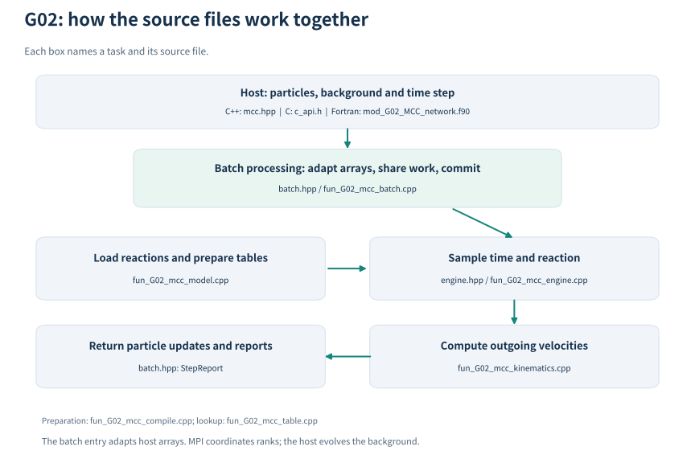

# G02_MCC_network

> [!TIP]
> MCC (Monte Carlo Collision) uses random draws to decide collision timing, reaction type and outcomes; ensemble statistics should follow the model.
>
> A null collision is a rejected candidate: sampled waiting time is consumed but the particle state stays unchanged. It is a sampling device, not a physical reaction.
>
> A majorant bounds the true collision rate from above. Candidates use this bound and are accepted with actual-rate/bound probability. Loose bounds waste candidates; violated bounds cause errors.
>
> The projectile is the tracked incoming particle. The primary outcome tells what happens to that original particle record: update, removal or species change. Background partners are described by density and temperature.
>
> AoS (Array of Structures) stores one record per particle; SoA (Structure of Arrays) stores separate arrays for fields such as x[] and v[]. Adapters expose either layout through one interface; the physical model is unchanged.
>

[中文](README.zh-CN.md) | [English](README.en.md)

CSV preparation: [blank templates, original examples and checker](../../tests/009_collision/G02_MCC_network/templates/README.en.md).

`G02_MCC_network` answers this question: **after a group of particles spends a short time colliding with the surrounding gas, how do their velocities, species and numbers change?**
It is AlgoPlasma's G02 collision module, used separately from G01.

MCC stands for Monte Carlo Collision. Monte Carlo means using random numbers to sample specified probabilities.
Individual collision times and outgoing directions vary, while the statistics of many particles should follow the specified physics.

> **Synthetic data warning.** The demonstration and collision-box packages in [tests/009_collision/G02_MCC_network/data/](../../tests/009_collision/G02_MCC_network/data/README.md) contain invented
> numbers. They exist only to exercise the software and must not be used for
> scientific conclusions.

## Start here

Start with the [zero-dimensional collision-box tutorial](../../tests/009_collision/G02_MCC_network/examples/collision_box/README.en.md).
It follows hot particles colliding with a colder gas, then explains running the example, reading the plots and interpreting the checks.
You only need speed, kinetic energy and averages to begin; plasma theory and C++ can come later.

From the AlgoPlasma root in a Linux/WSL terminal:

```sh
bash tests/009_collision/G02_MCC_network/examples/collision_box/run.sh
```

You need CMake 3.20 or newer, C/C++ compilers with C++20 support, and Python 3 with Matplotlib for plotting.
The script builds automatically; Fortran and MPI are not required for this default example.
After `collision_box: PASS`, open `results/thermalization.png` in the example directory.
With the defaults, A cools from about 3000 K towards 300 K and its mean drift approaches zero.
The tutorial explains prerequisites, all three plots and failure criteria.

| Your goal | Where to read |
|---|---|
| Understand collisions and thermalization; run a first example | [Collision-box tutorial](../../tests/009_collision/G02_MCC_network/examples/collision_box/README.en.md) |
| Understand the inputs and outputs | The physical picture and time-step sections below |
| Call G02 from your own program | Batch API and build sections below; complete examples in [C++ host example](../../tests/009_collision/G02_MCC_network/examples/host_pic/main.cpp) and [Fortran host example](../../tests/009_collision/G02_MCC_network/examples/host_fortran/main.f90) |
| Check the software | [Test guide](../../tests/009_collision/G02_MCC_network/README.en.md) |
| Edit reactions or study the implementation | Model tables and algorithm constraints below; [PERFORMANCE.md](../../tests/009_collision/G02_MCC_network/PERFORMANCE.md) for parallel performance |

## The physical picture

### Tracked particles and the background

G02 stores velocities, species and other properties for individual tracked particles.
`projectile` and `primary` refer to the particle currently being processed.
The surrounding gas is a **background**, described by density, temperature and mean velocity.
A collision partner's velocity is sampled from that background, avoiding the need to track every gas molecule.

A **two-body** reaction has one tracked particle and one background reactant.
A **three-body** reaction has one tracked particle and two background reactants.
G02 currently models these particle–background interactions; it does not pair two tracked particle populations explicitly.

### What can a collision change?

Elastic ball collisions are a useful starting point: the partners exchange momentum and kinetic energy while preserving the totals.
**Elastic scattering preserves the pair's total kinetic energy; one particle's energy can change.**
Internal particle structure introduces other outcomes:

| Process | Physical meaning | G02 algorithm |
|---|---|---|
| Elastic scattering | Velocities change; species and internal energies stay the same | G02 algorithm C02 |
| Excitation or de-excitation | Internal energy increases or decreases through exchange with kinetic energy | G02 algorithm C03 |
| Dissociation | A molecule breaks into products | G02 algorithm C04 |
| Ionization | An additional free electron is released | G02 algorithm C05 |
| Attachment or detachment | Electrons are captured or released in negative-ion processes | G02 algorithm C06 |
| Charge exchange | Electrons transfer between partners, changing their charges | G02 algorithm C07 |
| Recombination or mutual neutralization | Combination or electron transfer reduces the number of charged particles | G02 algorithm C08 |

A **species** is a particle type, such as an electron, atom or ion.
A **state** identifies an internal energy level of that species.
A **reaction channel** specifies one reaction's inputs, products and rate.
Several channels form the collision network.
Charge and declared elemental inventories must balance; energy accounting includes internal and radiated energy where applicable.

### How often do collisions occur?

Two common inputs describe how readily a reaction occurs:

- A **cross section** `sigma` (σ), in m², is an effective reaction area that can depend on relative kinetic energy.
  For a given relative speed `g`, `n × sigma × g` gives the corresponding collision frequency.
  A background velocity distribution also requires sampling or averaging over background velocities.
- A **two-body rate coefficient** `k`, in m³/s, multiplied by background number density `n` (particles per cubic metre),
  gives `nu = n × k`, in 1/s. G02 looks up these coefficients using the specified background temperature.

In the tutorial, `n = 1e20 m^-3` and `k = 1e-14 m^3/s`, giving one million collisions per second per A on average,
or a mean waiting time of one microsecond. Individual waits are random.
A three-body coefficient has units of m⁶/s and needs two background density factors to give a frequency.
Its numerical value cannot be compared directly with a two-body coefficient.

## What happens within a time step?

```text
Particle state + background density/temperature/mean velocity + reaction data + dt
                                      |
                         Sample the next candidate wait
                                      |
                  Beyond the remaining time? -- yes --> Particle finished
                                      |
                                      no
                                      |
                      Sample a channel and accept/reject
                         /                         \
            Real event: update state       Null event: keep state
                         \                         /
                         Process the remaining time
```

`dt` is the physical time handled by one call.
There may be zero, one or several collisions in it.
A **null collision** is a rejected candidate that leaves the particle unchanged.
G02 algorithm C01 samples when and which channel; G02 algorithm C02–C08 construct the result of a real collision.

The caller, also called the **host program**, supplies particles and background properties.
G02 returns particle updates, reaction counts and background exchange records.
For example, energy transferred from A to the gas appears as energy received by the background.
The host decides whether to use that record to evolve the background; the tutorial holds it fixed.

In a PIC (Particle-in-Cell) simulation, which combines particles with a spatial grid, G02 handles the collision step.
Other modules handle fields, position updates and boundaries.
Call `MccStepper::step()` once per time step for the entire particle batch.
If a batch step fails, the original particle data remain unchanged.
This all-or-nothing commit is what **transactional** means here.

The remaining sections are a reference for integration and model editing.
For a first reading, continue with the [collision-box tutorial](../../tests/009_collision/G02_MCC_network/examples/collision_box/README.en.md) and return here when needed.

## Layout

Separate Sphinx reference pages are available:

- [Architecture](../../docs/source/rst_files/G_Collision/G02_MCC_network/mod_G02_MCC_network.rst)
  and [data types](../../docs/source/rst_files/G_Collision/G02_MCC_network/mod_G02_MCC_network.rst).
- [Fortran routine directory](../../docs/source/rst_files/G_Collision/G02_MCC_network/mod_G02_MCC_network.rst)
  and [batch parameters](../../docs/source/rst_files/G_Collision/G02_MCC_network/sub_G02_mcc_step.rst).
- [C++ batch API](../../docs/source/rst_files/G_Collision/G02_MCC_network/fun_G02_mcc_batch.rst),
  [C API](../../docs/source/rst_files/G_Collision/G02_MCC_network/fun_G02_mcc_c_api.rst)
  and [MPI](../../docs/source/rst_files/G_Collision/G02_MCC_network/mod_G02_MCC_network_mpi.rst).



The original reference below remains available; the separate pages expand parameters, inputs, outputs and errors.

```text
G_Collision/G02_MCC_network/       functional code, templates and module guide
├── *.hpp, *.h                    C++ headers and C interfaces
├── *.cpp                        C++ implementations
├── fortran_interface/            Fortran calling interface
└── README*.md                    Chinese/English guides, including build commands

tests/009_collision/G02_MCC_network/
├── examples/                     complete callers and validation cases
│   ├── collision_box/            zero-dimensional box, tutorial, run and plot scripts
│   ├── host_pic/                 C++ host example
│   ├── host_fortran/             Fortran host example
│   └── mpi_collision_box/        MPI example
├── data/                         synthetic models and invalid-input fixtures
├── templates/blank/              blank CSV templates
├── tools/validate_model.cpp      model-package checker
├── cpp/, fortran/                regression tests
├── cmake/                        library build and installation recipes
├── CMakeLists.txt                build entry point
├── run.sh                        test runner
├── PERFORMANCE.md                parallel and performance guide
└── README*.md                    test guide
```

Headers and C++ implementation files sit directly in the G02 root, alongside `fortran_interface/`.
`fortran_interface/` provides Fortran entry points to the C++ collision implementation in the G02 root.
C++ callers use `#include "mcc.hpp"`; C callers use `#include "c_api.h"`.
Linking the CMake targets described below sets the header search path automatically.

### Source names and calls

G02 follows G01: `mod_G02_*` identifies modules, `sub_G02_*` contains subroutines,
and `fun_G02_*` contains function implementations. In Fortran, use `call` for a `sub_`
entry and use a `fun_` entry's returned value directly.

```text
fortran_interface/
├── mod_G02_MCC_network.f90        types, C bindings and include entry
├── sub_G02_mcc_load.f90           model loading
├── sub_G02_mcc_model_queries.f90  species, state and reaction queries
├── sub_G02_mcc_step.f90           batch collisions
├── sub_G02_mcc_collide.f90        single-particle collisions
├── sub_G02_mcc_session.f90        reusable session initialization/close
├── sub_G02_mcc_cleanup.f90        reports and resource cleanup
├── fun_G02_mcc_api_version.f90    interface version
├── mod_G02_MCC_network_mpi.f90    MPI module entry
├── sub_G02_mcc_mpi_session.f90    MPI sessions
└── sub_G02_mcc_mpi_step.f90       MPI batch collisions
```

Each module includes its `sub_` and `fun_` files after `contains`. Compile the module files;
do not compile those include files separately. C++ implementation files use
`fun_G02_mcc_*.cpp`: for example, `fun_G02_mcc_engine.cpp` implements `MccEngine`
and `fun_G02_mcc_batch.cpp` implements `MccStepper`.

Update prototype Fortran calls: `g02_mcc_load` → `sub_G02_mcc_load`,
`g02_mcc_step` → `sub_G02_mcc_step`, and `g02_mcc_api_version` → `fun_G02_mcc_api_version`.
Other public subroutines follow the same `sub_` prefix and uppercase `G02` tag;
examples and tests use the new names. Data types retain names such as `g02_mcc_particle`.
See the interface sections below for C and C++ calls.

## Design

The core uses C++20. The C ABI is a C function boundary for callers in other languages;
Fortran `ISO_C_BINDING` connects to those functions.
OpenMP shares work between CPU threads within a process; MPI coordinates multiple processes.
Neither is needed for the basic serial example.

- `SpeciesId`, `StateId`, `ReactionId`, `ParticleState`, `BackgroundComponent`,
  `CollisionRequest`, `PrimaryAction`, `CreatedProduct`, `ReservoirDelta`,
  `EventRecord`, `ConservationLedger` and `StepOutcome` describe everything a
  host PIC loop needs.
- Call `MccStepper::step()` once per PIC step to process all eligible particles,
  including updates, removals, species moves and new products. A `ParticleAdapter`
  connects it to a host-owned container.
- `MccEngine::collide()` remains available as the legacy single-particle API.
- The reaction core has no dependency on the host particle bank, checkpointing,
  diagnostic files, MPI or hard-coded species names. The batch layer has an
  optional OpenMP backend.

### G02 algorithm C01 candidate clock

A **majorant** is an upper bound on collision frequency, written `Lambda` (Λ).
Candidates are sampled at that higher frequency, then accepted with probability “real frequency / bound”.
Summing channel bounds gives the total bound; no active channels means no sampling.
Below, `u` is uniform from 0 to 1, excluding 1; `ln` is the natural logarithm;
`tau` is a candidate waiting time; and `safety` is a dimensionless margin factor.
`shape` bounds the rate factor obtained from the cross-section or rate-coefficient table.
Multiplication by density factors converts it into frequency.
For background MCC and the null-collision idea, see the
[WarpX collision documentation](https://warpx.readthedocs.io/en/26.02/theory/multiphysics/collisions.html#background-monte-carlo-collisions-mcc).
The event clock and interfaces described below are specific to G02.

The engine builds the total majorant `Lambda = sum_r majorant_r` over all
channels whose declared kinetic projectile is exactly the current
`(species, state)` pair. Each channel majorant is
`shape * density_product * safety`, where `density_product` is `n` for a
two-body rate, `n1*n2` for a mixed three-body rate and `n^2` when the same
background species carries stoichiometry 2. A candidate occurs when an
exponential time `tau = -ln(1-u)/Lambda` fits inside the remaining `dt`. The
channel is then drawn proportional to its majorant contribution, so multiple
background components compete automatically. A candidate is either a real event
or a null event; the particle is untouched by a null event. If the real rate
exceeds its compiled majorant the engine raises a hard error instead of
silently clipping.

A channel is only eligible when the primary state matches its
`projectile_state`; a state with no matching channel produces zero candidates.
After a real `Update` the engine rebuilds the active channel set and the total
majorant from the *new* primary state before sampling the remaining `dt`, so a
`ground -> excited` transition stops using ground-only channels immediately.
The batch API continues the remaining `dt` after `MoveSpecies`; `Remove` stops
the step. The legacy single-particle API still stops after a species move. A
null event keeps the channels unchanged. Only active-channel backgrounds are
required: a missing background is an error only when a channel for the current
state actually needs it.

### Physics algorithms

| Id | Semantics | Independent validation |
|----|-----------|------------------------|
| G02 algorithm C02 | elastic two-body | same species multiset on both sides, `q = 0`, no radiation |
| G02 algorithm C03 | discrete state transition | exactly two products, `q` must equal `-(U_after - U_before)` from `states.csv` |
| G02 algorithm C04 | dissociation / multi-product | at least two products, element and charge balance |
| G02 algorithm C05 | ionization | at least one additional free electron in the products |
| G02 algorithm C06 | attachment / detachment | electron projectile producing a negative heavy ion, or negative-ion projectile releasing a free electron |
| G02 algorithm C07 | charge exchange | exactly 2→2; `identity_exchange` additionally requires the same species multiset on both sides, two distinct species with different charge states, equal reactant masses (strict epsilon tolerance), `q = radiated = ker_min = 0`, and maps products by species |
| G02 algorithm C08 | recombination / mutual neutralization | the number of charged particles decreases |

All algorithms share the same, separately validated N-body kinematics helpers
(`fun_G02_mcc_kinematics.cpp`): two-body centre-of-mass separation with an isotropic or
explicit cone/cosine-range direction, `identity_exchange`, `n_body_phase_space`
and `equal_share`. Unsupported models (`opal_like`) are rejected at load time,
not relabelled. The two-body, N-body and equal-share final states all enforce
`ker_min_ev <=` the final relative kinetic energy, comparing energies with a
scale-aware tolerance derived from `std::numeric_limits<double>::epsilon()`
rather than the former fixed `1e-18` J (~6.24 eV) floor.

## Units and sign conventions

An eV (electronvolt) is a microscopic energy unit: 1 eV is about `1.602e-19 J`.
K means kelvin; kg, m and s are kilograms, metres and seconds.
Fields ending in `_ev` use eV, ledger energies ending in `_j` use joules, and velocities use m/s.

Internally the module uses eV, K, kg, m and s.

| Quantity | Unit |
|---|---|
| `cross_section` table `y` | m² (two-body only) |
| two-body `rate_coefficient` `y` | m³/s |
| three-body `rate_coefficient` `y` | m⁶/s |
| `threshold_ev` | eV, channel switch only |
| `q_value_ev` | eV, **positive releases energy, negative absorbs energy** |
| `ker_min_ev` | eV, minimum final product relative kinetic energy (`>0` is rejected for a single-product channel, and must be 0 for `identity_exchange`) |
| `radiated_energy_ev` | eV, energy diverted to radiation/unresolved channels |

`q_value_ev` is the net kinetic-energy change imposed on the products:
`KE_after = KE_before + q - radiated`. For G02 algorithm C03 the declared state energies must
satisfy `q + (U_after - U_before) = 0`. For ionization and recombination the
binding energy is carried by `q`; the states stay at their ground level.
`KE` means kinetic energy and `U` internal energy; before/after refer to the two sides of the collision.

`identity_exchange` is defined strictly: a 2→2 channel with the same species
multiset on both sides, two distinct species whose charge states differ and swap
roles, and equal reactant masses. The final-state mapping is defined by product
*species*, never by `products.csv` row order: the product with the projectile
species takes the sampled background velocity and the product with the
background species takes the projectile velocity. The shipped `demo_binary`
`M`/`M+` pair therefore has exactly equal masses.

## Model package schema (format version 1)

This schema table is a summary; the [model page](../../docs/source/rst_files/G_Collision/G02_MCC_network/fun_G02_mcc_model.rst) is the full reference for allowed values, required keys and defaults.

A package is a directory with a `manifest.csv` and the files it names.
Here **schema** means the format rules for those files.
CSV is a text table: the first row gives column names and each following row is a record.
Use this map before looking up the exact columns:

| What you describe | Files |
|---|---|
| Particle types, masses and charges | [`species.csv`](../../docs/source/rst_files/G_Collision/G02_MCC_network/fun_G02_mcc_model.rst) |
| Internal energy levels | [`states.csv`](../../docs/source/rst_files/G_Collision/G02_MCC_network/fun_G02_mcc_model.rst) |
| Reaction partners and products | `reactions.csv`, `reactants.csv`, `products.csv` |
| Rates and table lookups | `rate_laws.csv`, `datasets.csv`, `tables/*.csv` |
| Nuclear element composition for balance checks | Optional `composition.csv` |
| Which files the package uses | [`manifest.csv`](../../docs/source/rst_files/G_Collision/G02_MCC_network/fun_G02_mcc_model.rst) |

`manifest.csv` (`key,value`): required keys `format` (`g02-mcc-model-package`),
`format_version` (`1`), `name`, `version`, `species`, `states`, `reactions`,
`reactants`, `products`, `rate_laws`, `datasets`. The `composition` key (and
its file) is optional, and an optional `checksum.<relative path>` key holds a
16-hex-digit FNV-1a 64 checksum; when present it is verified.

| File | Columns |
|---|---|
| [`species.csv`](../../docs/source/rst_files/G_Collision/G02_MCC_network/fun_G02_mcc_model.rst) | `id,name,mass_kg,charge_state,representation` (`kinetic`/`background`) |
| [`states.csv`](../../docs/source/rst_files/G_Collision/G02_MCC_network/fun_G02_mcc_model.rst) | `id,species,label,energy_ev,degeneracy,is_ground` |
| [`composition.csv`](../../docs/source/rst_files/G_Collision/G02_MCC_network/fun_G02_mcc_model.rst) | `species,element,count` |
| [`reactions.csv`](../../docs/source/rst_files/G_Collision/G02_MCC_network/fun_G02_mcc_model.rst) | `id,name,algorithm,threshold_ev,q_value_ev,ker_min_ev,radiated_energy_ev,angular_model,angular_cos_min,angular_cos_max,energy_model,enabled` |
| [`reactants.csv`](../../docs/source/rst_files/G_Collision/G02_MCC_network/fun_G02_mcc_model.rst) | `reaction_id,role,species,state,stoichiometry` (`role` is `projectile`/`background`) |
| [`products.csv`](../../docs/source/rst_files/G_Collision/G02_MCC_network/fun_G02_mcc_model.rst) | `reaction_id,species,state,stoichiometry` |
| [`rate_laws.csv`](../../docs/source/rst_files/G_Collision/G02_MCC_network/fun_G02_mcc_model.rst) | `reaction_id,kind,dataset_id,x_source,x_species` |
| [`datasets.csv`](../../docs/source/rst_files/G_Collision/G02_MCC_network/fun_G02_mcc_model.rst) | `dataset_id,path,x_axis,x_unit,y_unit,interpolation,below_min_policy,above_max_policy,source,version,license,notes` |
| [`tables/*.csv`](../../docs/source/rst_files/G_Collision/G02_MCC_network/fun_G02_mcc_model.rst) | `x,y` |

CSV supports commas, double quotes and `""` escaping. Fields may not contain
newlines. Every error names the file and line.

Each reaction has exactly one kinetic projectile with stoichiometry 1 and one
or two background reactants; the total order must be 2 or 3. `cross_section` is
only allowed for two-body channels. `x_source` is `relative_energy_ev` for
cross sections and `temperature_k` (with `x_species` naming a background
reactant) for rate coefficients. Interpolation is `linear`, `log-linear` or
`log-log`; out-of-domain policies are `error`, `zero` or `clamp` and are
recorded in `datasets.csv`.

Validation rejects: unknown units or interpolation modes, duplicate species
ids/names, duplicate reaction ids **and reaction names**, unknown
species/states, NaN/Inf/negative values, non-increasing grids (temperature
grids must be non-negative), order/unit mismatches, unsupported angular/energy
models, a species without exactly one ground state, `reactants.csv` /
`products.csv` rows whose reaction id is not declared in `reactions.csv`, and
reactions that do not conserve elements or charge. The engine additionally
treats an out-of-domain sample as a hard error unless the dataset explicitly
declares `zero` or `clamp`.

`composition.csv` is optional, both as a manifest key/file and per species.
When a species has no composition row it contributes no atomic-nucleus element
inventory, so element balance is evaluated only over the species that do
declare one; this is intentional and must be stated when a package claims
element conservation.

Finite inputs never silently become non-finite: a density product, channel or
total majorant, sampled background velocity, relative energy, instantaneous
rate, final-state velocity, reservoir delta or conservation/ledger term that
overflows to `Inf` or becomes `NaN` is a hard `Error`. `relative_tolerance` and
the combined `majorant_safety_factor * diagnostic_majorant_scale` must be finite
at compile time.

## One Call Per PIC Step

This sketch requires the host's particle array and background-update functions.
See [examples/host_pic/main.cpp](../../tests/009_collision/G02_MCC_network/examples/host_pic/main.cpp) for a complete compilable caller.
`engine` loads reaction rules, `adapter` connects particle storage, `workspace` reuses temporary memory,
and `step()` handles one time step. The returned `reservoir` records what the background gains or loses.

```cpp
#include "mcc.hpp"
using namespace algoplasma::mcc;

MccEngine engine = MccEngine::load(model_dir);
MccStepper mcc(engine);
MccWorkspace workspace;
VectorParticleAdapter adapter(particles); // host-owned vector<ParticleState>
for (std::uint64_t step = 0; step < steps; ++step) {
    std::vector<CellBackground> gas = update_background_for_all_cells();
    StepReport result = mcc.step(adapter, gas, dt_s, step, seed, workspace);
    apply_reservoir_sources(result.reservoir);
}
```

The background-update and source-application functions in this sketch belong
to the host PIC program.

Backgrounds are keyed by `(cell, species, state)`. `cell=UINT32_MAX` provides
a uniform fallback only for cells without their own entries. Provide a density
for each background state, or use `state=invalid_state` for the legacy
species-aggregated density. States of one background species in one cell must
share temperature and drift. Missing backgrounds for active reactions raise an
error rather than silently disabling reactions.

`ParticleAdapter::prepare_commit()` may allocate but must not change visible
particles; `commit()` must not fail. Ready-made vector and SoA adapters follow
this contract. `begin_step()` refreshes SoA indices after host additions.
Keep the adapter or its `next_id_hint` across steps so deleted IDs
are not reused. Created products have `birth_step=global_step+1` and do not
collide in their birth step. Stable IDs determine random streams and reduction
order, yielding the same particle states, sources and ledger across input order
and OpenMP thread counts. Exceeding the configurable candidate limit (default
one million per particle) fails the whole step instead of truncating it.

See [C++ host example](../../tests/009_collision/G02_MCC_network/examples/host_pic/main.cpp) and [Fortran host example](../../tests/009_collision/G02_MCC_network/examples/host_fortran/main.f90) for buildable external
host examples. A Fortran CMake host enables both `Fortran` and `CXX` to link
the C++ core.


### step overloads

Overloading means one function name with different parameter lists. Use either call below for one physical time step, not both. The last argument is a workspace object, not options or thread count. All types are in `algoplasma::mcc`.

```cpp
auto report = stepper.step(adapter, background, dt_s, global_step, seed, workspace);
// Alternative: temporary workspace
// auto report = stepper.step(adapter, background, dt_s, global_step, seed);
```

[Complete C++ caller](../../tests/009_collision/G02_MCC_network/examples/doc_snippets/batch.cpp) initializes the engine, particles, background and workspace.

## Legacy Single-Particle C++ API

```cpp
#include "mcc.hpp"
using namespace algoplasma::mcc;

MccEngine engine = MccEngine::load("tests/009_collision/G02_MCC_network/data/demo_binary");

CollisionRequest request;
request.projectile.species = engine.species_id("e-");
request.projectile.state   = engine.state_id(request.projectile.species, "ground");
request.projectile.velocity = {2.0e6, 0.0, 0.0};
request.projectile.id = 42;
request.dt_s = 1.0e-8;
request.seed = 1234;

BackgroundComponent gas;
gas.species = engine.species_id("M");
gas.density_m3 = 2.0e20;
gas.temperature_k = 300.0;
request.background.push_back(gas);

StepOutcome outcome = engine.collide(request); // legacy API
```

## Minimal C ABI usage

Run with the model directory `tests/009_collision/G02_MCC_network/data/collision_box_elastic` as the first argument. The A/B names below belong to that synthetic model. 

```c
/* SPDX-License-Identifier: Apache-2.0 */
#include "c_api.h"
#include <stdio.h>

int main(int argc, char** argv) {
    if (argc != 2) return 2;
    char error[512] = {0};
    ap_g02_mcc_model* model = NULL;
    ap_g02_mcc_engine* engine = NULL;
    ap_g02_mcc_outcome* outcome = NULL;
    ap_g02_mcc_step_report* report = NULL;
    ap_g02_mcc_status status = AP_G02_MCC_OK;
    ap_g02_mcc_request request = {0};
    ap_g02_mcc_background gas = {0};
    ap_g02_mcc_particle particles[1] = {0};
    ap_g02_mcc_cell_background background[1] = {0};
    size_t count = 1, capacity = 1, required = 0;
    const uint32_t max_candidates = 0; /* default limit */
    const unsigned threads = 0;       /* runtime chooses thread count */
    const int backend = 0 /* Auto; 1 = Serial, 2 = OpenMP */;
#define CHECK(call) do { status = (call); if (status != AP_G02_MCC_OK) goto cleanup; } while (0)
    CHECK(ap_g02_mcc_model_load(argv[1], &model, error, sizeof(error)));
    CHECK(ap_g02_mcc_engine_create(model, &engine, error, sizeof(error)));
    CHECK(ap_g02_mcc_model_species_id(model, "A", &request.projectile.species, error, sizeof(error)));
    CHECK(ap_g02_mcc_model_state_id(model, request.projectile.species, "ground", &request.projectile.state, error, sizeof(error)));
    CHECK(ap_g02_mcc_model_species_id(model, "B", &gas.species, error, sizeof(error)));
    request.projectile.weight = 1.0;
    request.projectile.id = 1;
    request.projectile.velocity[0] = 1000.0;
    gas.density_m3 = 1.0e20;
    gas.temperature_k = 300.0;
    request.background = &gas;
    request.background_count = 1;
    request.dt_s = 1.0e-7;
    request.global_step = 0;
    request.seed = 1234;
    request.max_events_per_step = 0; /* model's default legacy limit */
    CHECK(ap_g02_mcc_collide(engine, &request, &outcome, error, sizeof(error)));
    /* This demo inspects API success only; legacy outcome is not auto-committed. */
    particles[0] = request.projectile;
    background[0].cell = 0; /* matches particles[0].cell */
    background[0].species = gas.species;
    CHECK(ap_g02_mcc_model_state_id(model, gas.species, "ground", &background[0].state, error, sizeof(error)));
    background[0].density_m3 = gas.density_m3;
    background[0].temperature_k = gas.temperature_k;
    CHECK(ap_g02_mcc_step(engine, particles, &count, capacity, &required,
        background, 1, request.dt_s, 0, request.seed,
        max_candidates, threads, backend, &report, error, sizeof(error)));
    puts("PASS");
cleanup:
    if (status != AP_G02_MCC_OK) fprintf(stderr, "status=%d %s\n", (int)status, error);
    ap_g02_mcc_step_report_destroy(report);
    ap_g02_mcc_outcome_destroy(outcome);
    ap_g02_mcc_engine_destroy(engine);
    ap_g02_mcc_model_destroy(model);
    return status == AP_G02_MCC_OK ? 0 : 1;
}
```

Except for `ap_g02_mcc_api_version`, functions return an `ap_g02_mcc_status`,
write bounded UTF-8 errors, and never let a C++ exception escape. Destroy
functions are null-safe.
The three options are `max_candidates=0` (default limit), `threads=0` (runtime choice), and `backend=0` (Auto; 1=Serial, 2=OpenMP).
For a whole PIC step use `ap_g02_mcc_step(engine, particles, &count, capacity,
&required, background, background_count, dt, step, seed, max_candidates, threads, backend, &report,
error, sizeof(error))`. The caller owns the array. On `AP_G02_MCC_BUFFER_TOO_SMALL`,
`required` gives the needed capacity and the original array/count are unchanged;
retry with the same step and seed. Use `ap_g02_mcc_model_*_count/get` to enumerate
species, states and reactions.
For repeated steps, `ap_g02_mcc_session_create`/`ap_g02_mcc_session_step` reuse a
workspace; `ap_g02_mcc_session_resume` commits after a capacity retry without
resampling.

## Minimal Fortran usage

Run with the model directory `tests/009_collision/G02_MCC_network/data/collision_box_elastic` as the first argument. The A/B names below belong to that synthetic model. 

```fortran
! SPDX-License-Identifier: Apache-2.0
program g02_documented_example
    use, intrinsic :: iso_c_binding
    use mod_G02_MCC_network
    implicit none
    type(g02_mcc_context) :: context
    type(g02_mcc_particle), allocatable :: particles(:)
    type(g02_mcc_cell_background) :: gas(1)
    type(g02_mcc_step_report) :: report
    integer(c_int) :: status
    character(len=2048) :: model_dir
    call get_command_argument(1, model_dir)
    if (len_trim(model_dir) == 0) stop 2
    call sub_G02_mcc_load(context, trim(model_dir), status)
    call check_status()
    allocate(particles(1))
    call sub_G02_mcc_species_id(context, "A", particles(1)%species, status)
    call check_status()
    call sub_G02_mcc_state_id(context, particles(1)%species, "ground", particles(1)%state, status)
    call check_status()
    particles(1)%id = 1_c_int64_t
    particles(1)%cell = 0_c_int32_t
    particles(1)%velocity(1) = 1000.0_c_double
    call sub_G02_mcc_species_id(context, "B", gas(1)%species, status)
    call check_status()
    call sub_G02_mcc_state_id(context, gas(1)%species, "ground", gas(1)%state, status)
    call check_status()
    gas(1)%cell = 0_c_int32_t ! Local cell; -1_c_int32_t means uniform fallback.
    gas(1)%density_m3 = 1.0e20_c_double
    gas(1)%temperature_k = 300.0_c_double
    call sub_G02_mcc_step(context, particles, gas, 1.0e-7_c_double, &
                         0_c_int64_t, 1234_c_int64_t, report, status)
    call check_status()
    print *, "PASS"
    call sub_G02_mcc_close(context)
contains
    subroutine check_status()
        if (status /= 0_c_int) then
            print *, trim(context%error_message)
            call sub_G02_mcc_close(context)
            stop 1
        end if
    end subroutine check_status
end program g02_documented_example
```

For batch use an allocatable `type(g02_mcc_particle) :: particles(:)` array and
`type(g02_mcc_cell_background) :: gas(:)` field with
`call sub_G02_mcc_step(context, particles, gas, dt_s, step, seed, report, status)`.
The adapter grows the array if needed and leaves it unchanged on failure.
For repeated steps, create a `g02_mcc_session` with `sub_G02_mcc_session_init`, pass
`session=session` to `sub_G02_mcc_step`, then call `sub_G02_mcc_session_close`.
In Fortran, write the uniform-background `cell=UINT32_MAX` as `-1_c_int32_t`.

## Legacy Single-Particle Host Commit Contract

`StepOutcome` never mutates the host particle store. A host should:

1. Call `collide()` on a copy of the particle state.
2. On success, apply `primary_action`:
   - `Update`: replace the projectile with `primary_after`; it may continue the
     remaining `dt`, which the engine has already done across multiple events.
   - `Remove`: delete the projectile.
   - `MoveSpecies`: delete the projectile and insert `primary_after` under
     `primary_destination`.
   - `None`: no real event; the particle is unchanged.
3. Insert every `CreatedProduct` (assigning its final global id in the host),
   remembering that its `birth_step` is `global_step + 1`, so it must not
   collide before the next global step.
4. Apply `ReservoirDelta` entries to the background source/sink bookkeeping.
5. On any `Error`, discard the outcome entirely: the engine performs no partial
   commit.

If the legacy `collide()` returns `event_limit_reached`, the remainder of `dt`
was not sampled after the default 64-event limit. The new `step()` never returns
a truncated step.

## Adding physics without touching the core

Adding a new species, a new supported two-body channel or a new three-body
channel requires only new CSV rows and a new `tables/*.csv` file. The engine
derives reaction order, density exponents, units and majorants from the package.

## Limitations

- MPI and OpenMP are optional CPU backends; CUDA is not included.
- No explicit projectile pairing / macroparticle-pair bookkeeping.
- `equal_share` is defined for exactly two product particles.
- `identity_exchange` is only valid for a resonant G02 algorithm C07 channel whose two
  reactant species have different charges and equal masses.
- `opal_like` angular/energy models are explicitly unimplemented and rejected.
- The C ABI makes no thread-safety promise in v1.
- The demo cross sections and rate coefficients are synthetic.

## Build and test

Run these commands from the AlgoPlasma root. The build entry point is `tests/009_collision/G02_MCC_network/CMakeLists.txt`;
it reads the functional sources from G02. By default it builds the library, tests and validation examples.
Use `G02_MCC_BUILD_TESTS=OFF`, shown below, to build only the library.

```bash
cmake -S tests/009_collision/G02_MCC_network -B /tmp/g02_mcc_tests -DCMAKE_BUILD_TYPE=Debug
cmake --build /tmp/g02_mcc_tests -j 4
ctest --test-dir /tmp/g02_mcc_tests --output-on-failure
```

Enable OpenMP and run the batch benchmark:

```bash
cmake -S tests/009_collision/G02_MCC_network -B /tmp/g02_mcc_omp \
  -DCMAKE_BUILD_TYPE=Release -DG02_MCC_ENABLE_OPENMP=ON
cmake --build /tmp/g02_mcc_omp -j 4
ctest --test-dir /tmp/g02_mcc_omp --output-on-failure
/tmp/g02_mcc_omp/bench_batch 1000000 100 7 8
```

For hybrid MPI/OpenMP builds, 1/2/4-rank tests, benchmark commands and API
usage, see [`PERFORMANCE.md`](../../tests/009_collision/G02_MCC_network/PERFORMANCE.md). Optional targets are
`AlgoPlasma::G02_MCC_MPI` (C++ and `mpi_c_api.h`) and
`AlgoPlasma::G02_MCC_Fortran_MPI`.

To build and install only the module, run from the repository root:

```bash
cmake -S tests/009_collision/G02_MCC_network -B /tmp/g02_mcc_module \
  -DCMAKE_BUILD_TYPE=Release -DG02_MCC_BUILD_TESTS=OFF
cmake --build /tmp/g02_mcc_module -j
cmake --install /tmp/g02_mcc_module --prefix /tmp/g02_mcc_install
```

The install step places the C++ library, the C ABI headers, the Fortran library
and the generated `mod_g02_mcc_network.mod` module (when Fortran is enabled),
plus a CMake package. An external host can use
`find_package(G02_MCC_network CONFIG REQUIRED)` and `AlgoPlasma::G02_MCC`
(`AlgoPlasma::G02_MCC_Fortran` for Fortran). Build [C++ host example](../../tests/009_collision/G02_MCC_network/examples/host_pic/main.cpp) with
`-DCMAKE_PREFIX_PATH=<install-prefix>` to verify external integration.

Installed C/C++ headers go to `<install-prefix>/include/G02_MCC_network/`,
and Fortran `.mod` files go to `<install-prefix>/include/`; the exported CMake targets include these paths.

Synthetic data and examples stay in `tests`. After installing the library, the caller supplies
the model-package path; the examples below use the test data in this repository.

## Zero-dimensional collision-box validation

[collision box](../../tests/009_collision/G02_MCC_network/examples/collision_box/README.en.md) uses the synthetic equal-mass elastic model in
[validation data](../../tests/009_collision/G02_MCC_network/data/collision_box_elastic/). It calls the batch MCC step once per time step and
checks conservation, Poisson collision counts, velocity-moment relaxation and
the final distribution; CTest also covers zero density, zero time step and
different step sizes. A failed check exits nonzero. Run
`tests/009_collision/G02_MCC_network/examples/collision_box/run.sh` from the repository
root. It generates CSV files and plots in the example's ignored `results/`
directory. See [`examples/collision_box/README.en.md`](../../tests/009_collision/G02_MCC_network/examples/collision_box/README.en.md)
for the analytic reference and pass criteria.

or, from a clean temporary directory with sanitizers:

```bash
bash tests/009_collision/G02_MCC_network/run.sh
```

`run.sh` creates its own `mktemp` directory by default. If `G02_MCC_BUILD_DIR`
is set it must be empty and must not be `/` or anywhere inside the source tree;
the script refuses otherwise and never runs an unguarded `rm -rf` on it.

## CSV template copy

The module includes [blank CSV templates](templates/blank/), alongside `fortran_interface/`. See [template instructions](templates/README.en.md).

### Special background IDs

`cell=UINT32_MAX` (C/C++), or `cell=-1_c_int32_t` (Fortran), selects a uniform fallback background. It is not a negative mesh index and is not one-based indexing. Ordinary cells must match particle cell IDs. `invalid_state` is the C++ uint16 sentinel 65535 (C: UINT16_MAX; Fortran: -1_c_int16_t), used only for legacy species-aggregate background lookup. It does not mean ground state or automatically split density between states. Prefer an explicit state ID from the model; tracked particle states must be valid.

### Build the documented callers

From the repository root:

```bash
cmake -S tests/009_collision/G02_MCC_network/examples/doc_snippets -B /tmp/g02_documented_callers
cmake --build /tmp/g02_documented_callers -j 4
ctest --test-dir /tmp/g02_documented_callers --output-on-failure
```
