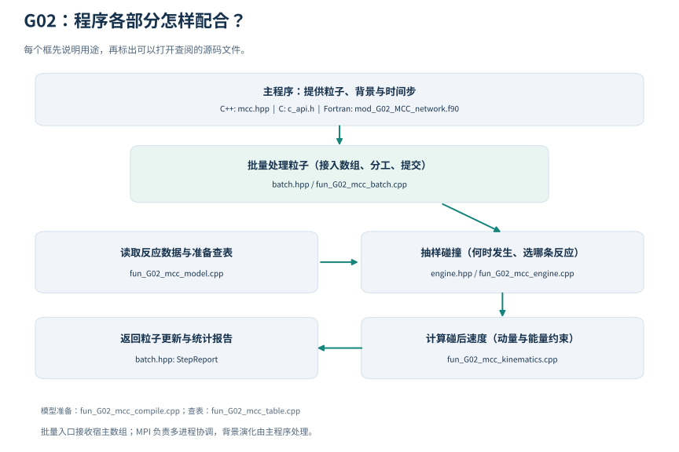

# G02_MCC_network

> [!TIP]
> MCC（Monte Carlo Collision，蒙特卡洛碰撞）：用随机抽样决定碰撞何时发生、发生哪种反应，以及粒子怎样变化；大量粒子的统计应符合给定模型。
>
> null collision（空碰撞）：算法安排的候选被拒绝，只消耗抽样等待时间，粒子状态不变。它是抽样技巧，不是一种新的物理反应。
>
> majorant（频率上界）：一个不小于真实碰撞频率的数，用它安排候选事件，再按“真实频率÷上界”接受候选。上界过松会增加空碰撞；低于真实频率则报错。
>
> projectile / primary：projectile 是当前跟踪的入射粒子；primary 是一次事件后对这条原粒子记录的处理结果，可更新、移除或改变物种。background 是用密度、温度等描述的碰撞伙伴。
>
> AoS / SoA 是存储排法：AoS（Array of Structures）按粒子存放 {x,v,…}；SoA（Structure of Arrays）分别存放 x[]、v[] 等字段数组。物理模型相同，适配器负责用统一接口访问这些数据。
>

[中文](README.zh-CN.md) | [English](README.en.md)

CSV 填写入口：[空白模板、原始示例与检查命令](../../tests/009_collision/G02_MCC_network/templates/README.zh-CN.md)。

`G02_MCC_network` 负责回答一个问题：**一群粒子经过一小段时间，与周围气体碰撞后，
速度、种类和数量会怎样变化？** 它是 AlgoPlasma 的 G02 碰撞模块，与 G01 分开使用。

MCC 是 Monte Carlo Collision（蒙特卡洛碰撞）的缩写。
“蒙特卡洛”指用随机数按给定概率抽样：单个粒子何时碰撞、碰后朝哪个方向运动可以不同，
大量粒子的统计结果应符合给定的物理规律。

> **合成数据警告**：[tests/009_collision/G02_MCC_network/data/](../../tests/009_collision/G02_MCC_network/data/README.md) 中的演示和碰撞盒数据都是为软件验证编造的，
> 不得用于任何科研结论。

## 第一次看，从哪里开始？

推荐先读[零维碰撞盒教程](../../tests/009_collision/G02_MCC_network/examples/collision_box/README.zh-CN.md)，它从“热粒子与冷气体碰撞”
讲起，再带你运行、看图和理解检查结果。只需知道速度、动能和平均数，
无需先掌握等离子体理论或 C++。

在 Linux/WSL 终端中，从 AlgoPlasma 仓库根目录运行：

```sh
bash tests/009_collision/G02_MCC_network/examples/collision_box/run.sh
```

需要 CMake 3.20 或以上、C/C++ 编译器（C++ 支持 C++20），绘图需要 Python 3 和 Matplotlib。
脚本自动构建；该算例默认不需要 Fortran 或 MPI。
看到 `collision_box: PASS` 后，打开算例目录下 `results/thermalization.png`：
默认情况下，A 的温度从约 3000 K 接近 300 K，整体漂移逐渐接近零。
完整的运行前提、三张图的含义及失败判据都在教程里。

| 你想做什么 | 读哪里 |
|---|---|
| 看懂碰撞与热化，跑第一个例子 | [零维碰撞盒教程](../../tests/009_collision/G02_MCC_network/examples/collision_box/README.zh-CN.md) |
| 理解 G02 需要什么输入、返回什么 | 本页下面的“物理图像”和“程序如何处理一段时间” |
| 在自己的程序里调用 | 本页后半部分的批量接口、构建与测试；完整示例在 [C++ 宿主示例](../../tests/009_collision/G02_MCC_network/examples/host_pic/main.cpp) 和 [Fortran 宿主示例](../../tests/009_collision/G02_MCC_network/examples/host_fortran/main.f90) |
| 检查软件是否正常 | [测试说明](../../tests/009_collision/G02_MCC_network/README.zh-CN.md) |
| 修改反应数据或研究实现 | 本页的模型包表格、算法约束；并行性能见 [PERFORMANCE.md](../../tests/009_collision/G02_MCC_network/PERFORMANCE.md) |

## 先建立物理图像

### 我们跟踪谁，背景又是什么？

G02 逐个保存一组粒子的速度、种类等信息；文中的 `projectile` 或 `primary` 指当前被处理的粒子。
周围气体用密度、温度和平均速度描述，称为**背景**。碰撞时从背景中抽样一个搭档的速度。
这样就能研究许多次碰撞，而无需保存气体中每一个分子的轨迹。

“二体”表示一次反应有两个反应物：一个被跟踪的粒子和一个背景粒子。
“三体”则有一个被跟踪的粒子和两个背景反应物。
G02 当前处理这种“粒子与背景”的关系，不负责把两组已跟踪粒子逐对配对。

### 碰撞会改变什么？

高中力学中的弹性小球碰撞是一个好起点：两球可以交换动量和动能，总量保持不变。
**弹性只保证双方总动能守恒，单个粒子的动能可以改变。**
如果把粒子的内部结构也考虑进来，还会有更多结果：

| 名称 | 直观含义 | G02 算法 |
|---|---|---|
| 弹性碰撞 | 改变速度，粒子种类和内部能量保持不变 | G02 算法 C02 |
| 激发或退激发 | 内部能量升高或降低，与运动能量交换 | G02 算法 C03 |
| 解离 | 分子被拆成几个产物 | G02 算法 C04 |
| 电离 | 释放出额外的自由电子 | G02 算法 C05 |
| 附着或脱附 | 捕获或释放电子，改变负离子的形成情况 | G02 算法 C06 |
| 电荷交换 | 碰撞伙伴之间转移电子，改变各自带电情况 | G02 算法 C07 |
| 复合或互中和 | 带电粒子结合或交换电子，使带电粒子数减少 | G02 算法 C08 |

“物种”是粒子的种类，例如电子、某种原子或离子；“态”是同一物种的内部能级。
“反应通道”是一条具体的变化规则，包含反应物、产物和发生快慢。
多条通道合在一起就是这里所说的“碰撞网络”。
碰撞过程中，电荷和已声明的元素数量要守恒；动能还需与内部能量、辐射等收支一起核算。

### 碰撞有多频繁？

两个常用数据描述碰撞的难易：

- **截面** `sigma`（σ），单位 m²，表示一次相遇发生指定反应的有效面积。
  它可以随相对运动能量变化。给定相对速率 `g` 时，`n × sigma × g` 给出相应的碰撞频率；
  背景速度有分布时，还要考虑对背景速度的抽样或平均。
- **二体速率系数** `k`，单位 m³/s，乘背景数密度 `n`（每立方米粒子数）后，
  得到该通道的碰撞频率 `nu = n × k`，单位 1/s。G02 的这类数据按指定背景温度查表。

例如算例中 `n = 1e20 m^-3`、`k = 1e-14 m^3/s`，所以每个 A 平均每秒碰撞一百万次，
平均等待时间为一微秒。每次实际等待多久是随机的。
三体速率系数的单位为 m⁶/s，要乘两个背景密度才得到 1/s；
它与二体速率系数的数值不能直接比较。

## 程序如何处理一段时间？

```text
粒子当前状态 + 背景密度/温度/平均速度 + 反应数据 + 时间步 dt
                              |
                      抽样下一个候选等待时间
                              |
                超出剩余时间？—— 是 → 本粒子本步完成
                              |
                              否
                              |
                     抽样通道并判断是否接受
                    /                       \
          真实碰撞：按模型更新       空碰撞：粒子状态不变
                    \                       /
                     继续处理本步剩余时间
```

`dt` 是一次调用要处理的物理时间；一个时间步内可能没有、一次或多次碰撞。
空碰撞（null collision）是概率抽样中被拒绝的候选，不改变粒子。
下文的 G02 算法 C01 负责抽样“何时、哪条通道”，G02 算法 C02–C08 负责计算真实碰撞后的结果。

调用方（也称“宿主程序”）提供粒子和背景，G02 返回更新后的粒子、反应计数及背景收支。
例如 A 把能量传给背景，收支中就记下背景收到的能量。
是否用它更新背景温度，由宿主决定；零维教程把背景保持固定。

在 PIC（Particle-in-Cell，粒子与网格结合的模拟方法）程序中，
G02 只负责碰撞环节，场求解、位置推进和边界处理由其他模块完成。
推荐每步调用一次 `MccStepper::step()`，一次处理全部粒子。
如果本步失败，批量接口保留原粒子数据；这个“全部成功才提交”的做法称为**事务化**。

下面是接入程序或修改模型时的参考内容。第一次学习可以先转到
[碰撞盒教程](../../tests/009_collision/G02_MCC_network/examples/collision_box/README.zh-CN.md)，运行后再回来查阅。

## 目录结构

程序说明现在有独立的 Sphinx 页面，可以按用途查阅：

- [架构与调用流程](../../docs/source/rst_files/G_Collision/G02_MCC_network/mod_G02_MCC_network.rst)、
  [粒子/背景/报告字段](../../docs/source/rst_files/G_Collision/G02_MCC_network/mod_G02_MCC_network.rst)。
- [Fortran 子程序目录](../../docs/source/rst_files/G_Collision/G02_MCC_network/mod_G02_MCC_network.rst)、
  [批量步进参数](../../docs/source/rst_files/G_Collision/G02_MCC_network/sub_G02_mcc_step.rst)。
- [C++ 批量接口](../../docs/source/rst_files/G_Collision/G02_MCC_network/fun_G02_mcc_batch.rst)、
  [C 接口](../../docs/source/rst_files/G_Collision/G02_MCC_network/fun_G02_mcc_c_api.rst)、
  [MPI 调用](../../docs/source/rst_files/G_Collision/G02_MCC_network/mod_G02_MCC_network_mpi.rst)。



本页后面的原有说明继续保留，独立页面提供更细的参数、输入输出和错误处理。

```text
G_Collision/G02_MCC_network/       功能代码与模块说明
├── *.hpp、*.h                    C++ 头文件与 C 接口
├── *.cpp                        C++ 实现
├── fortran_interface/            Fortran 调用接口
└── README*.md                    中英文说明（含编译方法）

tests/009_collision/G02_MCC_network/
├── examples/                     完整调用程序与验证算例
│   ├── collision_box/            零维碰撞盒、教程、运行与绘图脚本
│   ├── host_pic/                 C++ 宿主示例
│   ├── host_fortran/             Fortran 宿主示例
│   └── mpi_collision_box/        MPI 示例
├── data/                         合成数据与错误输入测试数据
├── templates/blank/              CSV 空白模板
├── tools/validate_model.cpp      模型包检查工具
├── cpp/、fortran/                 回归测试
├── cmake/                        库的构建与安装配置
├── CMakeLists.txt                构建入口
├── run.sh                        自动测试脚本
├── PERFORMANCE.md                并行与性能说明
└── README*.md                    测试说明
```

头文件和 C++ 实现文件直接放在 G02 根目录，与 `fortran_interface/` 同级。
`fortran_interface/` 提供 Fortran 调用入口，实际碰撞计算由根目录中的 C++ 实现完成。
C++ 调用程序使用 `#include "mcc.hpp"`，C 调用程序使用 `#include "c_api.h"`；
链接下文的 CMake 目标后，头文件搜索路径会自动设置。

### 源码命名与调用方式

G02 与 G01 使用同一套文件命名：`mod_G02_*` 是模块入口，`sub_G02_*` 是子程序文件，
`fun_G02_*` 是函数实现文件。Fortran 的 `sub_` 入口用 `call` 调用，`fun_` 入口直接返回值。

```text
fortran_interface/
├── mod_G02_MCC_network.f90        类型、C 绑定和 include 入口
├── sub_G02_mcc_load.f90           加载模型
├── sub_G02_mcc_model_queries.f90  查询物种、态和反应
├── sub_G02_mcc_step.f90           批量碰撞
├── sub_G02_mcc_collide.f90        单粒子碰撞
├── sub_G02_mcc_session.f90        初始化/关闭可复用会话
├── sub_G02_mcc_cleanup.f90        报告转换和资源释放
├── fun_G02_mcc_api_version.f90    返回接口版本
├── mod_G02_MCC_network_mpi.f90    MPI 模块入口
├── sub_G02_mcc_mpi_session.f90    MPI 会话
└── sub_G02_mcc_mpi_step.f90       MPI 批量碰撞
```

`mod_` 文件在 `contains` 中引入对应的 `sub_`、`fun_` 文件，构建时只编译 `mod_` 文件，
避免把同一例程编译两次。C++ 实现文件统一为 `fun_G02_mcc_*.cpp`，例如
`fun_G02_mcc_engine.cpp` 实现 `MccEngine`，`fun_G02_mcc_batch.cpp` 实现 `MccStepper`。

原型中的 Fortran 调用需要同步使用新名：`g02_mcc_load` → `sub_G02_mcc_load`，
`g02_mcc_step` → `sub_G02_mcc_step`，`g02_mcc_api_version` → `fun_G02_mcc_api_version`。
其他公开子程序也按相同规则添加 `sub_` 并将编号写成 `G02`；示例和测试已使用新名。
类型名仍写作 `g02_mcc_particle` 等，C/C++ 调用方式见后面的接口说明。

## 设计要点

核心代码使用 C++20；C ABI 是供其他语言调用的 C 函数边界，
Fortran 的 `ISO_C_BINDING` 用来连接这些 C 函数。
OpenMP 让同一进程内的多个 CPU 线程分工；MPI 让多个进程协作。基础串行算例无需它们。

- 公共类型包括 `SpeciesId`、`StateId`、`ReactionId`、`ParticleState`、
  `BackgroundComponent`、`CollisionRequest`、`PrimaryAction`、`CreatedProduct`、
  `ReservoirDelta`、`EventRecord`、`ConservationLedger`、`StepOutcome`。
- 推荐在 PIC 时间循环中调用一次 `MccStepper::step()`；它处理本步全部合格粒子，
  并提交粒子更新、删除、物种迁移和新产物。`ParticleAdapter` 对接宿主已有容器。
- `MccEngine::collide()` 保留为兼容旧程序的单粒子底层接口。
- 反应核心不依赖宿主 `ParticleBank`、checkpoint、诊断文件或 MPI，
  也不硬编码任何物种名；批量层提供可选的 OpenMP（共享内存并行）后端。

### G02 算法 C01 候选时钟

majorant（频率上界）是一个保证不小于真实碰撞频率的数，记作 `Lambda`（Λ）。
先按这个较高频率抽样候选，再按“真实频率 ÷ 上界”接受候选，就能得到所需真实频率。
各通道的上界相加得到总上界；没有活动通道时不需要抽样。
下式中 `u` 是 0 到 1 之间的均匀随机数（不取 1），`ln` 是自然对数，
`tau` 是候选等待时间，`safety` 是给上界留余量的无量纲系数。
`shape` 是由截面表或速率系数表得到的速率因子上界，乘密度后才得到频率。
背景 MCC 和空碰撞的通用思路也可参阅
[WarpX 的碰撞说明](https://warpx.readthedocs.io/en/26.02/theory/multiphysics/collisions.html#background-monte-carlo-collisions-mcc)；
G02 的具体事件时钟和接口以下文为准。

引擎只对 projectile 的**当前 `(species, state)` 完全匹配**的通道求总 majorant
`Lambda = sum_r majorant_r`。单通道 majorant 为
`shape * density_product * safety`：二体速率为 `n`，混合三体为 `n1*n2`，
同种背景计量为 2 时为 `n^2`。当指数时间 `tau = -ln(1-u)/Lambda` 落在剩余 `dt`
内时产生候选事件；通道按 majorant 份额竞争，因此多个背景组分自动竞争。
候选分为真实事件或 null 事件，null 事件不改变粒子。若实际速率超过编译出的
majorant，直接硬错误，绝不静默截断。

当 primary 状态与通道声明的 `projectile_state` 不匹配时该通道不可用；没有任何
适用通道时产生零候选。真实 `Update` 之后，引擎在采样剩余 `dt` 之前按新的 primary
状态重建活动通道与总 majorant，因此 `ground -> excited` 会立即停止使用仅 ground
的通道；批量接口在 `MoveSpecies` 后继续采样剩余 `dt`，`Remove` 终止本步；
旧单粒子接口仍在 `MoveSpecies` 时停止。null 事件不重建。只有活动通道的背景才会
被要求，缺失背景只在当前状态确实需要该通道时报错。

### 物理算法

| 编号 | 语义 | 独立校验 |
|------|------|----------|
| G02 算法 C02 | 二体弹性 | 两侧物种计量完全相同，`q = 0`，无辐射 |
| G02 算法 C03 | 离散态跃迁 | 恰好两个产物，`q` 必须等于 `-(U_after - U_before)` |
| G02 算法 C04 | 解离/多产物 | 至少两个产物，元素与电荷守恒 |
| G02 算法 C05 | 电离 | 产物中至少多出一个自由电子 |
| G02 算法 C06 | 附着/脱附 | 电子入射生成负重离子，或负离子入射释放自由电子 |
| G02 算法 C07 | 电荷交换 | 严格 2→2；`identity_exchange` 还要求两侧物种计量相同、两个物种不同且电荷角色互换、反应物质量严格相等（epsilon 容差）、`q = radiated = ker_min = 0`，并按产物物种映射速度 |
| G02 算法 C08 | 复合/互中和 | 带电粒子数必须减少 |

所有算法共享独立验证的 N 体运动学辅助（`fun_G02_mcc_kinematics.cpp`）：质心系二体分离
（各向同性或显式 cone/cosine-range）、`identity_exchange`、`n_body_phase_space`、
`equal_share`。未实现的模型（如 `opal_like`）在加载阶段直接拒绝，不换标签。
二体、N 体与 equal_share 末态都验证 `ker_min_ev <=` 末态相对动能，能量比较使用
由 `std::numeric_limits<double>::epsilon()` 导出的尺度相关容差，不再使用固定的
`1e-18` J（约 6.24 eV）下限。

## 单位与符号约定

eV（电子伏特）是微观能量单位，1 eV 约为 `1.602e-19 J`；
K 是温度单位开尔文，kg、m、s 分别表示千克、米、秒。
字段名带 `_ev` 的数值用 eV，带 `_j` 的账本能量用 J，速度用 m/s。

内部统一使用 eV、K、kg、m、s。

| 量 | 单位 |
|----|------|
| `cross_section` 表 `y` | m²（仅二体） |
| 二体 `rate_coefficient` `y` | m³/s |
| 三体 `rate_coefficient` `y` | m⁶/s |
| `threshold_ev` | eV，仅控制通道阈值 |
| `q_value_ev` | eV，**正值放能、负值吸能** |
| `ker_min_ev` | eV，最低末态相对动能约束（单产物通道 `>0` 编译拒绝；`identity_exchange` 必须为 0） |
| `radiated_energy_ev` | eV，辐射/未分辨能量 |

`q_value_ev` 是产物净动能变化：`KE_after = KE_before + q - radiated`。
`KE` 表示动能，`U` 表示内部能量；before/after 分别表示碰撞前后。
G02 算法 C03 要求 `q + (U_after - U_before) = 0`。电离与复合的束缚能由 `q` 承载，
态能量保持基态。

`identity_exchange` 的定义是严格的：2→2，两侧物种计量相同，两个物种不同且电荷
角色互换，反应物质量相等。末态映射由产物**物种**决定，与 `products.csv` 行顺序
无关：projectile 物种的产物取采样到的背景速度，background 物种的产物取 projectile
速度。因此 `demo_binary` 的 `M`/`M+` 质量完全相等。

## 模型包 schema（format version 1）

这里的 schema 表是摘要；允许值、必填键和留空默认等完整规范以 [model 页面](../../docs/source/rst_files/G_Collision/G02_MCC_network/fun_G02_mcc_model.rst) 为准。

数据包目录由 `manifest.csv` 及其列出的文件组成。
schema 指文件需要遵守的格式规则。CSV 是能用文本编辑器打开的表格：
第一行是列名，后面的每一行是一条记录。先看文件分工，再按后面的列名填写：

| 想描述什么 | 文件 |
|---|---|
| 有哪些粒子，质量和带电量是多少 | [`species.csv`](../../docs/source/rst_files/G_Collision/G02_MCC_network/fun_G02_mcc_model.rst) |
| 同一种粒子有哪些内部能级 | [`states.csv`](../../docs/source/rst_files/G_Collision/G02_MCC_network/fun_G02_mcc_model.rst) |
| 哪些粒子碰撞，生成什么 | `reactions.csv`、`reactants.csv`、`products.csv` |
| 每条反应有多快，怎样查表 | `rate_laws.csv`、`datasets.csv`、`tables/*.csv` |
| 原子核元素的组成，用于核算元素守恒 | 可选的 `composition.csv` |
| 这个模型使用上面哪些文件 | [`manifest.csv`](../../docs/source/rst_files/G_Collision/G02_MCC_network/fun_G02_mcc_model.rst) |

`manifest.csv`（`key,value`）必需键：`format`（`g02-mcc-model-package`）、
`format_version`（`1`）、`name`、`version`、`species`、`states`、
`reactions`、`reactants`、`products`、`rate_laws`、`datasets`。`composition`
键及其文件是可选的；可选 `checksum.<相对路径>` 保存 16 位十六进制 FNV-1a 64
校验和，存在即校验。

| 文件 | 列 |
|------|----|
| [`species.csv`](../../docs/source/rst_files/G_Collision/G02_MCC_network/fun_G02_mcc_model.rst) | `id,name,mass_kg,charge_state,representation`（`kinetic`/`background`） |
| [`states.csv`](../../docs/source/rst_files/G_Collision/G02_MCC_network/fun_G02_mcc_model.rst) | `id,species,label,energy_ev,degeneracy,is_ground` |
| [`composition.csv`](../../docs/source/rst_files/G_Collision/G02_MCC_network/fun_G02_mcc_model.rst) | `species,element,count` |
| [`reactions.csv`](../../docs/source/rst_files/G_Collision/G02_MCC_network/fun_G02_mcc_model.rst) | `id,name,algorithm,threshold_ev,q_value_ev,ker_min_ev,radiated_energy_ev,angular_model,angular_cos_min,angular_cos_max,energy_model,enabled` |
| [`reactants.csv`](../../docs/source/rst_files/G_Collision/G02_MCC_network/fun_G02_mcc_model.rst) | `reaction_id,role,species,state,stoichiometry` |
| [`products.csv`](../../docs/source/rst_files/G_Collision/G02_MCC_network/fun_G02_mcc_model.rst) | `reaction_id,species,state,stoichiometry` |
| [`rate_laws.csv`](../../docs/source/rst_files/G_Collision/G02_MCC_network/fun_G02_mcc_model.rst) | `reaction_id,kind,dataset_id,x_source,x_species` |
| [`datasets.csv`](../../docs/source/rst_files/G_Collision/G02_MCC_network/fun_G02_mcc_model.rst) | `dataset_id,path,x_axis,x_unit,y_unit,interpolation,below_min_policy,above_max_policy,source,version,license,notes` |
| [`tables/*.csv`](../../docs/source/rst_files/G_Collision/G02_MCC_network/fun_G02_mcc_model.rst) | `x,y` |

CSV 支持逗号、双引号和 `""` 转义，字段内不允许换行；所有错误都包含文件名与行号。

每条反应恰有一个计量为 1 的 kinetic projectile，以及一或两个 background 反应物，
总阶数只能是 2 或 3。`cross_section` 仅允许二体。`x_source` 对截面为
`relative_energy_ev`，对速率系数为 `temperature_k`（`x_species` 指定背景反应物）。
插值支持 `linear`、`log-linear`、`log-log`；域外策略为 `error`、`zero`、`clamp`。

校验会拒绝：未知单位/插值、重复物种 ID/名称、重复反应 ID **与反应名**、未知物种/状态、
NaN/Inf/负值、非递增网格（温度网格必须非负）、阶数与单位不符、未实现的角/能量模型、
某物种没有恰好一个基态、`reactants.csv`/`products.csv` 中引用了 `reactions.csv` 未声明
的 reaction id，以及元素或电荷不守恒。引擎还把域外采样视为硬错误，除非数据集显式声明
`zero` 或 `clamp`。

`composition.csv` 是可选的：manifest 键/文件和每物种的行都可以缺省。某物种没有
composition 行即表示它不贡献原子核元素库存，元素守恒只对声明了 composition 的物种
求值；这是有意的，数据包若声称元素守恒必须说明这一点。

有限输入不会静默变为非有限：密度乘积、通道/总 majorant、采样背景速度、相对能量、
瞬时速率、末态速度、reservoir delta 以及守恒/总账项若上溢为 `Inf` 或出现 `NaN`，
一律抛硬错误。`relative_tolerance` 与
`majorant_safety_factor * diagnostic_majorant_scale` 在编译期必须是有限值。

## 每步一次的批量接口

下面是调用结构示意，需要宿主已有粒子数组和背景更新函数。
可直接编译的完整程序在 [examples/host_pic/main.cpp](../../tests/009_collision/G02_MCC_network/examples/host_pic/main.cpp)。
`engine` 读取反应规则，`adapter` 连接粒子数组，`workspace` 复用临时内存，
`step()` 执行一个时间步，返回的 `reservoir` 是背景收到或失去的量。

```cpp
#include "mcc.hpp"
using namespace algoplasma::mcc;

MccEngine engine = MccEngine::load(model_dir);
MccStepper mcc(engine);                       // 默认按规模选择串行或 OpenMP
MccWorkspace workspace;                       // 跨步复用通道和批量缓冲区
VectorParticleAdapter adapter(particles);     // particles 是宿主持有的 vector<ParticleState>
for (std::uint64_t step = 0; step < steps; ++step) {
    std::vector<CellBackground> gas = update_background_for_all_cells();
    StepReport result = mcc.step(adapter, gas, dt_s, step, seed, workspace);
    apply_reservoir_sources(result.reservoir); // 宿主负责背景场的时间推进
}
```

示例里的背景更新和源项应用函数由宿主 PIC 程序实现。

`CellBackground` 的键是 `(cell, species, state)`；`cell=UINT32_MAX` 是全空间
默认场，只有某个 cell 没有自己的背景条目时才使用。可提供每个背景态的密度，
也可用 `state=invalid_state` 为该物种提供旧版的态合并密度。同一 cell 内同一
物种的各态必须共享温度和漂移速度。缺少活动通道所需背景会报错，不会静默跳过。

`ParticleAdapter` 的 `prepare_commit()` 可以申请内存，但不得修改当前可见粒子；
`commit()` 必须不失败。`VectorParticleAdapter` 与 `SoaParticleAdapter` 已实现这一
约定；`begin_step()` 会在每次调用时更新 SoA 索引，识别宿主新增粒子。
自有 AoS/SoA（结构体数组/数组的结构体）容器只需实现一次适配器。
适配器或其 `next_id_hint` 必须跨时间步保留，避免粒子删除后重新分配旧 ID。
新产物的 `birth_step=global_step+1`，本步不再碰撞。粒子按稳定 ID 排序后用
`seed/global_step/id/event_index` 生成随机数；不同输入顺序和 OpenMP 线程数的
粒子结果、源项与总账可重复。超出 `max_candidates_per_particle`（默认一百万）
直接报错，整步粒子不提交，不会像旧接口的默认 64 次上限那样丢失剩余时间。

更多可直接构建的宿主示例见 [C++ 宿主示例](../../tests/009_collision/G02_MCC_network/examples/host_pic/main.cpp) 和
[Fortran 宿主示例](../../tests/009_collision/G02_MCC_network/examples/host_fortran/main.f90)。Fortran 宿主通过 CMake 使用安装目标时，工程同时启用
`Fortran` 与 `CXX` 语言以链接 C++ 核心。

不接入 PIC 其他模块的 MCC 验证示例见 [零维碰撞盒](../../tests/009_collision/G02_MCC_network/examples/collision_box/README.zh-CN.md)：零维固定背景，
一条命令生成热化曲线、速度分布和逐粒子碰撞次数统计。


### step 的两个重载

“重载”就是同名函数支持不同参数列表。一个物理时间步只选下面一种调用，不要两种都执行。最后一个参数是工作区对象，不是 options 或线程数；类型均位于 `algoplasma::mcc`。

```cpp
auto report = stepper.step(adapter, background, dt_s, global_step, seed, workspace);
// 备选：临时工作区
// auto report = stepper.step(adapter, background, dt_s, global_step, seed);
```

[完整 C++ 调用程序](../../tests/009_collision/G02_MCC_network/examples/doc_snippets/batch.cpp)给出了 engine、粒子、背景与工作区的初始化。

## 单粒子兼容接口

```cpp
#include "mcc.hpp"
using namespace algoplasma::mcc;

MccEngine engine = MccEngine::load("tests/009_collision/G02_MCC_network/data/demo_binary");

CollisionRequest request;
request.projectile.species = engine.species_id("e-");
request.projectile.state   = engine.state_id(request.projectile.species, "ground");
request.projectile.velocity = {2.0e6, 0.0, 0.0};
request.projectile.id = 42;
request.dt_s = 1.0e-8;
request.seed = 1234;

BackgroundComponent gas;
gas.species = engine.species_id("M");
gas.density_m3 = 2.0e20;
gas.temperature_k = 300.0;
request.background.push_back(gas);

StepOutcome outcome = engine.collide(request); // 旧接口，失败时抛 Error
```

## C ABI 最小用法

运行时把 `tests/009_collision/G02_MCC_network/data/collision_box_elastic` 作为第一个命令行参数；以下 A/B 名称来自这套合成模型。

```c
/* SPDX-License-Identifier: Apache-2.0 */
#include "c_api.h"
#include <stdio.h>

int main(int argc, char** argv) {
    if (argc != 2) return 2;
    char error[512] = {0};
    ap_g02_mcc_model* model = NULL;
    ap_g02_mcc_engine* engine = NULL;
    ap_g02_mcc_outcome* outcome = NULL;
    ap_g02_mcc_step_report* report = NULL;
    ap_g02_mcc_status status = AP_G02_MCC_OK;
    ap_g02_mcc_request request = {0};
    ap_g02_mcc_background gas = {0};
    ap_g02_mcc_particle particles[1] = {0};
    ap_g02_mcc_cell_background background[1] = {0};
    size_t count = 1, capacity = 1, required = 0;
    const uint32_t max_candidates = 0; /* default limit */
    const unsigned threads = 0;       /* runtime chooses thread count */
    const int backend = 0 /* Auto; 1 = Serial, 2 = OpenMP */;
#define CHECK(call) do { status = (call); if (status != AP_G02_MCC_OK) goto cleanup; } while (0)
    CHECK(ap_g02_mcc_model_load(argv[1], &model, error, sizeof(error)));
    CHECK(ap_g02_mcc_engine_create(model, &engine, error, sizeof(error)));
    CHECK(ap_g02_mcc_model_species_id(model, "A", &request.projectile.species, error, sizeof(error)));
    CHECK(ap_g02_mcc_model_state_id(model, request.projectile.species, "ground", &request.projectile.state, error, sizeof(error)));
    CHECK(ap_g02_mcc_model_species_id(model, "B", &gas.species, error, sizeof(error)));
    request.projectile.weight = 1.0;
    request.projectile.id = 1;
    request.projectile.velocity[0] = 1000.0;
    gas.density_m3 = 1.0e20;
    gas.temperature_k = 300.0;
    request.background = &gas;
    request.background_count = 1;
    request.dt_s = 1.0e-7;
    request.global_step = 0;
    request.seed = 1234;
    request.max_events_per_step = 0; /* model's default legacy limit */
    CHECK(ap_g02_mcc_collide(engine, &request, &outcome, error, sizeof(error)));
    /* This demo inspects API success only; legacy outcome is not auto-committed. */
    particles[0] = request.projectile;
    background[0].cell = 0; /* matches particles[0].cell */
    background[0].species = gas.species;
    CHECK(ap_g02_mcc_model_state_id(model, gas.species, "ground", &background[0].state, error, sizeof(error)));
    background[0].density_m3 = gas.density_m3;
    background[0].temperature_k = gas.temperature_k;
    CHECK(ap_g02_mcc_step(engine, particles, &count, capacity, &required,
        background, 1, request.dt_s, 0, request.seed,
        max_candidates, threads, backend, &report, error, sizeof(error)));
    puts("PASS");
cleanup:
    if (status != AP_G02_MCC_OK) fprintf(stderr, "status=%d %s\n", (int)status, error);
    ap_g02_mcc_step_report_destroy(report);
    ap_g02_mcc_outcome_destroy(outcome);
    ap_g02_mcc_engine_destroy(engine);
    ap_g02_mcc_model_destroy(model);
    return status == AP_G02_MCC_OK ? 0 : 1;
}
```

除版本查询函数外，接口返回 `ap_g02_mcc_status`，写入有界 UTF-8 错误信息，
不允许 C++ 异常越界；destroy 对 NULL 安全。
在 PIC 循环里改用 `ap_g02_mcc_step(engine, particles, &count, capacity, &required,
background, background_count, dt, step, seed, max_candidates, threads, backend, &report, error, sizeof(error))`。
`max_candidates=0` 使用默认候选次数上限，`threads=0` 由运行时选择线程数，`backend=0` 为 Auto（1=Serial，2=OpenMP）。这三个零分别控制不同选项。
`particles` 是宿主自己的连续数组；容量不够时返回 `AP_G02_MCC_BUFFER_TOO_SMALL`
并写出 `required`，原数组与 `count` 不变，扩容后用同样的 `step`/`seed` 重试。
高频调用推荐 `ap_g02_mcc_session_create`/`ap_g02_mcc_session_step`；容量不足时
`ap_g02_mcc_session_resume` 延续已准备的碰撞，不重新抽样。
物种/状态/反应可通过 `ap_g02_mcc_model_*_count/get` 枚举。

## Fortran 最小用法

运行时把 `tests/009_collision/G02_MCC_network/data/collision_box_elastic` 作为第一个命令行参数；以下 A/B 名称来自这套合成模型。

```fortran
! SPDX-License-Identifier: Apache-2.0
program g02_documented_example
    use, intrinsic :: iso_c_binding
    use mod_G02_MCC_network
    implicit none
    type(g02_mcc_context) :: context
    type(g02_mcc_particle), allocatable :: particles(:)
    type(g02_mcc_cell_background) :: gas(1)
    type(g02_mcc_step_report) :: report
    integer(c_int) :: status
    character(len=2048) :: model_dir
    call get_command_argument(1, model_dir)
    if (len_trim(model_dir) == 0) stop 2
    call sub_G02_mcc_load(context, trim(model_dir), status)
    call check_status()
    allocate(particles(1))
    call sub_G02_mcc_species_id(context, "A", particles(1)%species, status)
    call check_status()
    call sub_G02_mcc_state_id(context, particles(1)%species, "ground", particles(1)%state, status)
    call check_status()
    particles(1)%id = 1_c_int64_t
    particles(1)%cell = 0_c_int32_t
    particles(1)%velocity(1) = 1000.0_c_double
    call sub_G02_mcc_species_id(context, "B", gas(1)%species, status)
    call check_status()
    call sub_G02_mcc_state_id(context, gas(1)%species, "ground", gas(1)%state, status)
    call check_status()
    gas(1)%cell = 0_c_int32_t ! Local cell; -1_c_int32_t means uniform fallback.
    gas(1)%density_m3 = 1.0e20_c_double
    gas(1)%temperature_k = 300.0_c_double
    call sub_G02_mcc_step(context, particles, gas, 1.0e-7_c_double, &
                         0_c_int64_t, 1234_c_int64_t, report, status)
    call check_status()
    print *, "PASS"
    call sub_G02_mcc_close(context)
contains
    subroutine check_status()
        if (status /= 0_c_int) then
            print *, trim(context%error_message)
            call sub_G02_mcc_close(context)
            stop 1
        end if
    end subroutine check_status
end program g02_documented_example
```

Fortran 的批量调用使用可分配数组：

```fortran
type(g02_mcc_particle), allocatable :: particles(:)
type(g02_mcc_cell_background) :: gas(1)
type(g02_mcc_step_report) :: report
! 填充 particles(:) 和 gas(:)，每个 PIC 步调用一次：
call sub_G02_mcc_step(context, particles, gas, dt_s, step, seed, report, status)
! 成功后 particles 已更新；report%reservoir 是按 cell/species/state 汇总的源项。
```

该适配层自动扩容并重试，失败时保留原粒子数组。
高频调用可先 `sub_G02_mcc_session_init(context, session, status)`，再给
`sub_G02_mcc_step(..., session=session)` 传入会话，最后 `sub_G02_mcc_session_close(session)`。
Fortran 中均匀背景的 `cell=UINT32_MAX` 写成 `-1_c_int32_t`。

## 单粒子接口的宿主提交约定

`StepOutcome` 从不修改宿主粒子存储。宿主应：

1. 用粒子状态副本调用 `collide()`。
2. 成功后按 `primary_action` 提交：
   - `Update`：用 `primary_after` 替换原粒子；引擎已在剩余 `dt` 内处理多个事件；
   - `Remove`：删除原粒子；
   - `MoveSpecies`：删除原粒子，以 `primary_destination` 插入 `primary_after`；
   - `None`：无真实事件，粒子不变。
3. 插入所有 `CreatedProduct`（由宿主分配最终全局 ID），注意其 `birth_step` 为
   `global_step + 1`，下一步才能参与碰撞。
4. 把 `ReservoirDelta` 应用到背景源汇账本。
5. 任何 `Error` 都必须整体丢弃该步结果：引擎不会部分提交。

旧 `collide()` 若返回 `event_limit_reached`，说明达到 `max_events_per_step`
（默认 64），剩余 `dt` 未被完整采样；新 `step()` 不返回截断结果。

## 只改数据即可扩展

新增物种、新增已支持模型的二体通道或三体通道，只需增加 CSV 行和
`tables/*.csv`。反应阶数、密度指数、单位和 majorant 都由数据包推导。

## 限制

- MPI 和 OpenMP 均为可选 CPU 并行后端；不包含 CUDA。
- 不做显式粒子配对。
- `equal_share` 仅支持恰好两个产物粒子。
- `identity_exchange` 仅用于共振 G02 算法 C07 通道，且两个反应物物种电荷不同、质量相等。
- `opal_like` 等模型明确未实现并加载失败。
- v1 不承诺 C ABI 线程安全。
- 演示截面与速率系数均为合成数据。

## 构建与测试

编译命令都从 AlgoPlasma 仓库根目录运行。构建入口放在 `tests/009_collision/G02_MCC_network/CMakeLists.txt`，
它读取 G02 的功能代码。默认同时构建库、测试和验证算例；只需要库时，使用下文的 `G02_MCC_BUILD_TESTS=OFF`。

```bash
cmake -S tests/009_collision/G02_MCC_network -B /tmp/g02_mcc_tests -DCMAKE_BUILD_TYPE=Debug
cmake --build /tmp/g02_mcc_tests -j 4
ctest --test-dir /tmp/g02_mcc_tests --output-on-failure
```

启用 OpenMP 后端与批量基准测试：

```bash
cmake -S tests/009_collision/G02_MCC_network -B /tmp/g02_mcc_omp \
  -DCMAKE_BUILD_TYPE=Release -DG02_MCC_ENABLE_OPENMP=ON
cmake --build /tmp/g02_mcc_omp -j 4
ctest --test-dir /tmp/g02_mcc_omp --output-on-failure
/tmp/g02_mcc_omp/bench_batch 1000000 100 7 8
```

MPI 与 OpenMP 混合构建、1/2/4 rank 测试及基准用法见
[`PERFORMANCE.md`](../../tests/009_collision/G02_MCC_network/PERFORMANCE.md)。MPI 的 C++、C 和 Fortran 目标分别为
`AlgoPlasma::G02_MCC_MPI`、同目标提供的 `mpi_c_api.h`、
`AlgoPlasma::G02_MCC_Fortran_MPI`。

只构建和安装模块时，从仓库根目录运行：

```bash
cmake -S tests/009_collision/G02_MCC_network -B /tmp/g02_mcc_module \
  -DCMAKE_BUILD_TYPE=Release -DG02_MCC_BUILD_TESTS=OFF
cmake --build /tmp/g02_mcc_module -j
cmake --install /tmp/g02_mcc_module --prefix /tmp/g02_mcc_install
```

安装会放入 C++ 库、C ABI 头、Fortran 库以及生成的
`mod_g02_mcc_network.mod`（启用 Fortran 时）及 CMake 包配置。外部 PIC 工程
可使用 `find_package(G02_MCC_network CONFIG REQUIRED)` 和
`AlgoPlasma::G02_MCC`；Fortran 目标为 `AlgoPlasma::G02_MCC_Fortran`。
[C++ 宿主示例](../../tests/009_collision/G02_MCC_network/examples/host_pic/main.cpp) 可用 `-DCMAKE_PREFIX_PATH=<安装前缀>` 独立构建。

安装后的 C/C++ 头文件位于 `<安装前缀>/include/G02_MCC_network/`，
Fortran 的 `.mod` 文件位于 `<安装前缀>/include/`；CMake 导出的目标包含这些路径。

合成数据和示例保留在 `tests` 中。安装库后，由调用程序传入模型包路径；
下文示例使用仓库中的测试数据。

## 零维碰撞盒验证

[零维碰撞盒](../../tests/009_collision/G02_MCC_network/examples/collision_box/README.zh-CN.md) 使用 [算例数据](../../tests/009_collision/G02_MCC_network/data/collision_box_elastic/) 中的合成等质量弹性碰撞模型。
它每步调用一次批量 MCC，并自动检查守恒、碰撞次数的泊松统计、速度矩弛豫和末态分布；
零密度、零时间步及不同时间步长也由 CTest 覆盖。检查失败时程序返回非零状态。
从仓库根目录运行 `tests/009_collision/G02_MCC_network/examples/collision_box/run.sh`，
CSV 和图片生成在该示例已忽略的 `results/` 目录。参数、解析参照和结果判据见
[`examples/collision_box/README.zh-CN.md`](../../tests/009_collision/G02_MCC_network/examples/collision_box/README.zh-CN.md)。

或在全新临时目录中带 sanitizer：

```bash
bash tests/009_collision/G02_MCC_network/run.sh
```

`run.sh` 默认创建 `mktemp` 目录。若设置 `G02_MCC_BUILD_DIR`，该目录必须为空，
且不得为 `/` 或位于源码树内；否则脚本拒绝执行，并且绝不会对它执行无保护的
`rm -rf`。

## CSV 模板拷贝

模块内提供[空白 CSV 模板](templates/blank/)，`templates/` 与 `fortran_interface/` 同级。[模板说明](templates/README.md)提供复制和检查命令。

### 背景中的特殊编号

`cell=UINT32_MAX`（C/C++）或 `cell=-1_c_int32_t`（Fortran）表示全域备用背景，不是负网格号，也不是从 1 开始的数组下标。普通 cell 要和粒子的网格编号一致。`invalid_state` 是 C++ 的 16 位无符号哨兵值 65535（C 用 UINT16_MAX，Fortran 用 -1_c_int16_t），仅用于旧式按物种合并的背景查找；它不表示基态，也不会自动按能级分配密度。推荐从模型查询明确的态 ID；被跟踪粒子的 state 必须有效。

### 构建文档中的调用示例

在仓库根目录运行：

```bash
cmake -S tests/009_collision/G02_MCC_network/examples/doc_snippets -B /tmp/g02_documented_callers
cmake --build /tmp/g02_documented_callers -j 4
ctest --test-dir /tmp/g02_documented_callers --output-on-failure
```
