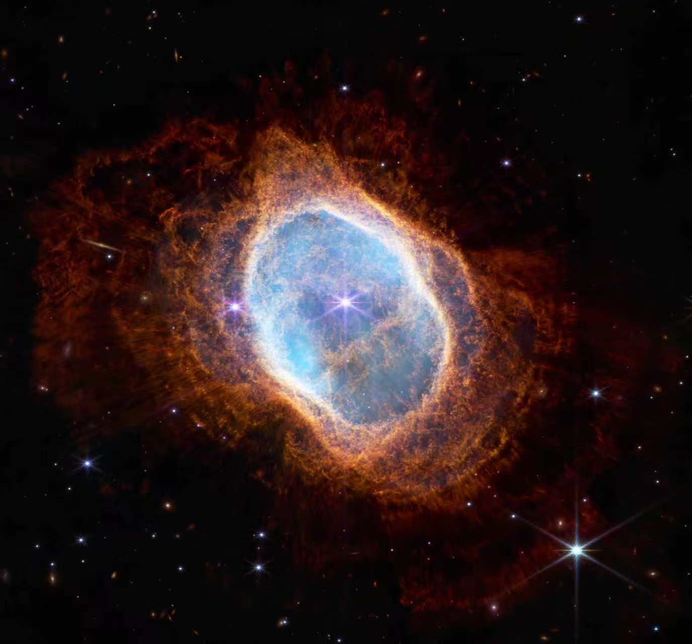

# AlgoPlasma: Open Algorithms for Plasma Modeling

[中文](README.zh-CN.md) | [English](README.en.md)

AlgoPlasma, formerly PMSL, turns scattered and repeatedly reimplemented core algorithms for plasma modeling into an open, reusable, tested, and explainable algorithm library. It supports reliable modeling and result verification in research, while also helping learners understand algorithmic principles and gain hands-on experience in education. By bringing the community's efforts together, AlgoPlasma aims to build a shared algorithmic foundation so that others can build upon it instead of starting from scratch.

## Repository Layout

```text
AlgoPlasma
├── A_Pusher          # Particle pushers
├── B_Scatter         # Particle-to-grid deposition
├── C_Gather          # Grid-to-particle interpolation
├── D_Poisson         # Poisson solvers and electric field post-processing
├── E_Maxwell         # Maxwell / FDTD solvers
├── F_IO              # Data input and output
├── G_Collision       # Collision models
├── H_MPI_Exchange    # MPI data exchange
├── I_Initializer     # Initialization
├── J_Fluid           # Fluid algorithms
├── docs              # Sphinx + Doxygen documentation
└── tests             # Algorithm tests and validation cases
```

An algorithm unit usually contains:

- Core implementation files, such as Fortran subroutine/function files, C/C++ source files, Python scripts, and related files.
- A module entry point or wrapper interface, such as a Fortran `mod_*.f90` file.
- A `README.md` or RST document explaining the algorithm purpose, equations, and interface.
- Test cases that validate numerical correctness, stability, convergence, or physical behavior.
- Optional visualization scripts, reference results, and educational notes.

## Implementation Languages

AlgoPlasma does not restrict implementation languages. The current repository is mostly Fortran, with some C helper code and Python scripts for testing, initialization, and plotting. Future contributions in C, C++, Python, CUDA, Julia, or other suitable languages are welcome.

## Quick Start

AlgoPlasma is currently organized mainly as a source-level algorithm library. Fortran modules are typically integrated through `mod_*.f90` entry files, which use C preprocessor `#include` directives to include the actual subroutines.

Example: call the 3D Boris particle pusher.

```fortran
#include "A_Pusher/A01_Boris_3Dxyz/mod_A01_Boris_3Dxyz.f90"

program demo_boris
    use mod_A01_Boris_3Dxyz
    implicit none

    real :: v(3), E(3), B(3), k

    v = (/1.0, 0.0, 0.0/)
    E = 0.0
    B = (/0.0, 0.0, 1.0/)
    k = 0.01

    call sub_A01_Boris_3Dxyz(v, E, B, k)
end program demo_boris
```

Compilation usually requires C preprocessing:

```bash
gfortran -cpp -O2 -fdefault-real-8 demo_boris.f90
```

Some modules may require extra dependencies such as MPI, OpenMP, HYPRE, or HDF5. See the corresponding algorithm and test directories for details.

## Tests

Tests live under `tests/`. Many test directories include:

- `make.sh`: build the test program.
- `run.sh`: run the test.
- `clean.sh`: remove generated files.
- `README.md`: explain the test objective, physical setup, and validation criteria.

For example, run the Maxwell FDTD single-step formula tests:

```bash
cd tests/005_maxwell/case_fdtd_single_step_formula
bash run.sh
```

After changing an algorithm, start with the most local tests for that algorithm, then run longer or more complete physical validation cases as needed.

## Documentation

The documentation is built with Sphinx, Doxygen, and Breathe:

- Doxygen comments in source files are used to generate API documentation.
- `docs/source/developer_onboarding.rst` provides quick-start paths for users and new contributors.
- `docs/source/rst_files/` contains algorithm notes, derivations, testing guides, and figures.
- `docs/source/creat_rst.py` helps generate or update some RST pages.

Typical documentation build workflow:

```bash
pip install -r docs/requirements.txt
cd docs
make html
```

Doxygen is also required on the system. The Read the Docs configuration is in `.readthedocs.yaml`. After a successful build, the HTML entry page is usually at `docs/build/html/index.html`; open that file in a browser to view the documentation.

## Contributing

Contributions are welcome for any algorithm implementation, test case, documentation, or validation result that serves plasma science.

A new algorithm contribution should ideally include:

- A clearly named algorithm directory.
- The core implementation and any necessary wrapper interface.
- Documentation for parameters, units, array layout, and boundary conventions.
- Algorithm equations, applicability notes, and key references.
- An independently runnable test or validation case.
- Python visualization or data-analysis scripts when useful.

Please keep algorithm units independent, interfaces clear, and dependencies explicit. For improvements to an existing algorithm, document whether the numerical behavior changes and update the corresponding tests when needed.

## Contributors

This list is generated from `contributors.yml`; do not edit this section by hand. Run `python3 tools/generate_contributors.py` to regenerate it.

<!-- CONTRIBUTORS:START -->
<p align="center"><sub>Thanks to everyone contributing code, tests, benchmarks, documentation, examples, and bug fixes to the project.</sub></p>

### Project Lead

<table class="ap-work-list ap-work-list--lead">
  <thead>
    <tr>
      <th scope="col" align="left" width="160">Member</th>
      <th scope="col" align="left">Biography</th>
    </tr>
  </thead>
  <tbody>
    <tr>
      <td class="ap-member" align="center" width="160" valign="top">
        <div class="ap-member-profile">
          <span class="ap-member-avatar"><a href="https://github.com/Yin-YinjianZhao"></a></span>
          <div class="ap-member-identity">
            <strong><a href="https://github.com/Yin-YinjianZhao">Yinjian Zhao</a></strong><br>
            <sub class="ap-member-role">Project Lead</sub>
          </div>
        </div>
      </td>
      <td class="ap-work-cell" valign="top">
        <p class="ap-member-biography">Associate Professor and PhD Supervisor at Harbin Institute of Technology. He received his PhD in Astronautical Engineering from the University of Southern California, USA, and conducted postdoctoral research at Lawrence Berkeley National Laboratory, USA. He contributed to the development of the open-source WarpX code under the U.S. Department of Energy's Exascale Computing Project. His research focuses on plasma physics and numerical simulation, including electric propulsion, plasma instabilities, particle simulation algorithms, and high-performance parallel computing. He has published more than 40 SCI-indexed papers and led several research projects, including a national young talent program and General Program projects funded by the National Natural Science Foundation of China. He serves on the Young Editorial Board of Plasma Science and Technology and reviews for Chinese and international journals in plasma physics and computational physics, including Plasma Sources Science and Technology, Physics of Plasmas, and Computer Physics Communications.</p>
      </td>
    </tr>
  </tbody>
</table>

### Maintainers

<table class="ap-work-list">
  <thead>
    <tr>
      <th scope="col" align="left" width="160">Member</th>
      <th scope="col" align="left">Research Interests and Documented Work</th>
    </tr>
  </thead>
  <tbody>
    <tr>
      <td class="ap-member" align="center" width="160" valign="top">
        <div class="ap-member-profile">
          <span class="ap-member-avatar"><a href="https://gitee.com/HermiteCat"></a></span>
          <div class="ap-member-identity">
            <strong><a href="https://gitee.com/HermiteCat">Baisheng Wang</a></strong><br>
            <sub class="ap-member-role">Maintainer</sub>
          </div>
        </div>
      </td>
      <td class="ap-work-cell" valign="top">
        <p class="ap-member-research"><strong>Research Interests</strong><br>Numerical simulation of hollow cathodes for space electric propulsion</p>
        <ul class="ap-work-items">
          <li><a href="docs/source/rst_files/D_Poisson/D01_hypre_3Dxyz.rst">HYPRE interface for the 3D Cartesian Poisson equation</a></li>
          <li><a href="docs/source/rst_files/D_Poisson/D02_hypre_3Dxyz_bc.rst">3D Cartesian Poisson solving with boundary conditions</a></li>
          <li><a href="docs/source/rst_files/D_Poisson/D03_hypre_3Draz_uniform.rst">3D Poisson solving on a uniform cylindrical grid</a></li>
          <li><a href="docs/source/rst_files/D_Poisson/D04_hypre_3Draz_nonuniform.rst">3D Poisson solving on a nonuniform cylindrical grid</a></li>
        </ul>
      </td>
    </tr>
    <tr>
      <td class="ap-member" align="center" width="160" valign="top">
        <div class="ap-member-profile">
          <span class="ap-member-avatar"></span>
          <div class="ap-member-identity">
            <strong>Changzheng Hu</strong><br>
            <sub class="ap-member-role">Maintainer</sub>
          </div>
        </div>
      </td>
      <td class="ap-work-cell" valign="top">
        <span class="ap-work-pending">To be added</span>
      </td>
    </tr>
    <tr>
      <td class="ap-member" align="center" width="160" valign="top">
        <div class="ap-member-profile">
          <span class="ap-member-avatar"></span>
          <div class="ap-member-identity">
            <strong>Kunpeng Zhong</strong><br>
            <sub class="ap-member-role">Maintainer</sub>
          </div>
        </div>
      </td>
      <td class="ap-work-cell" valign="top">
        <span class="ap-work-pending">To be added</span>
      </td>
    </tr>
    <tr>
      <td class="ap-member" align="center" width="160" valign="top">
        <div class="ap-member-profile">
          <span class="ap-member-avatar"><a href="https://orcid.org/0009-0009-6248-9781"></a></span>
          <div class="ap-member-identity">
            <strong><a href="https://orcid.org/0009-0009-6248-9781">Lihuan Xie</a></strong><br>
            <sub class="ap-member-role">Maintainer</sub>
          </div>
        </div>
      </td>
      <td class="ap-work-cell" valign="top">
        <ul class="ap-work-items">
          <li><a href="docs/source/rst_files/G_Collision/G01_MCC.rst">Null-collision Monte Carlo collision handling</a></li>
        </ul>
      </td>
    </tr>
    <tr>
      <td class="ap-member" align="center" width="160" valign="top">
        <div class="ap-member-profile">
          <span class="ap-member-avatar"></span>
          <div class="ap-member-identity">
            <strong>Wushun Zhang</strong><br>
            <sub class="ap-member-role">Maintainer</sub>
          </div>
        </div>
      </td>
      <td class="ap-work-cell" valign="top">
        <span class="ap-work-pending">To be added</span>
      </td>
    </tr>
    <tr>
      <td class="ap-member" align="center" width="160" valign="top">
        <div class="ap-member-profile">
          <span class="ap-member-avatar"></span>
          <div class="ap-member-identity">
            <strong>Xi Chen</strong><br>
            <sub class="ap-member-role">Maintainer</sub>
          </div>
        </div>
      </td>
      <td class="ap-work-cell" valign="top">
        <span class="ap-work-pending">To be added</span>
      </td>
    </tr>
    <tr>
      <td class="ap-member" align="center" width="160" valign="top">
        <div class="ap-member-profile">
          <span class="ap-member-avatar"><a href="https://gitee.com/Luo-Xin-410"></a></span>
          <div class="ap-member-identity">
            <strong><a href="https://gitee.com/Luo-Xin-410">Xin Luo</a></strong><br>
            <sub class="ap-member-role">Maintainer</sub>
          </div>
        </div>
      </td>
      <td class="ap-work-cell" valign="top">
        <ul class="ap-work-items">
          <li><a href="docs/source/rst_files/C_Gather/C02_gather_3Dxyz_bspline.rst">B-spline field gathering on a 3D Cartesian grid</a></li>
        </ul>
      </td>
    </tr>
    <tr>
      <td class="ap-member" align="center" width="160" valign="top">
        <div class="ap-member-profile">
          <span class="ap-member-avatar"><a href="https://gitee.com/jiaohuadetudouni"></a></span>
          <div class="ap-member-identity">
            <strong><a href="https://gitee.com/jiaohuadetudouni">Yingjie Chen</a></strong><br>
            <sub class="ap-member-role">Maintainer</sub>
          </div>
        </div>
      </td>
      <td class="ap-work-cell" valign="top">
        <span class="ap-work-pending">To be added</span>
      </td>
    </tr>
    <tr>
      <td class="ap-member" align="center" width="160" valign="top">
        <div class="ap-member-profile">
          <span class="ap-member-avatar"><a href="https://gitee.com/lzhe898"></a></span>
          <div class="ap-member-identity">
            <strong><a href="https://gitee.com/lzhe898">Zhe Liu</a></strong><br>
            <sub class="ap-member-role">Maintainer</sub>
          </div>
        </div>
      </td>
      <td class="ap-work-cell" valign="top">
        <ul class="ap-work-items">
          <li><a href="docs/source/rst_files/E_Maxwell/E01_Maxwell_2Drz.rst">FDTD updates for axisymmetric 2D cylindrical Maxwell equations</a></li>
          <li><a href="docs/source/rst_files/E_Maxwell/E02_Maxwell_3Drtz.rst">FDTD updates for 3D cylindrical Maxwell equations</a></li>
          <li><a href="docs/source/rst_files/E_Maxwell/E03_Maxwell_3Dxyz.rst">FDTD updates for 3D Cartesian Maxwell equations</a></li>
          <li><a href="docs/source/rst_files/F_IO/F01_par_load.rst">Parallel particle data loading</a></li>
          <li><a href="docs/source/rst_files/F_IO/F02_par_output.rst">Parallel particle data output</a></li>
          <li><a href="docs/source/rst_files/F_IO/F03_field_load.rst">Parallel field data loading</a></li>
          <li><a href="docs/source/rst_files/F_IO/F04_field_output.rst">Parallel field data output</a></li>
        </ul>
      </td>
    </tr>
    <tr>
      <td class="ap-member" align="center" width="160" valign="top">
        <div class="ap-member-profile">
          <span class="ap-member-avatar"><a href="https://gitee.com/HIT-ZhouZhijun"></a></span>
          <div class="ap-member-identity">
            <strong><a href="https://gitee.com/HIT-ZhouZhijun">Zhijun Zhou</a></strong><br>
            <sub class="ap-member-role">Maintainer</sub>
          </div>
        </div>
      </td>
      <td class="ap-work-cell" valign="top">
        <ul class="ap-work-items">
          <li><a href="docs/source/rst_files/B_Scatter/B02_deposit_3d_cyl.rst">Charge and current deposition on a 3D cylindrical grid</a></li>
        </ul>
      </td>
    </tr>
    <tr>
      <td class="ap-member" align="center" width="160" valign="top">
        <div class="ap-member-profile">
          <span class="ap-member-avatar"><a href="https://github.com/GooseGH"></a></span>
          <div class="ap-member-identity">
            <strong><a href="https://github.com/GooseGH">Zhongping Zhao</a></strong><br>
            <sub class="ap-member-role">Maintainer</sub>
          </div>
        </div>
      </td>
      <td class="ap-work-cell" valign="top">
        <ul class="ap-work-items">
          <li><a href="docs/source/rst_files/A_Pusher/A01_Boris_3Dxyz.rst">Nonrelativistic Boris particle pushing in 3D Cartesian coordinates</a></li>
          <li><a href="docs/source/rst_files/A_Pusher/A02_Boris_3Drtz.rst">Nonrelativistic Boris particle pushing in 3D cylindrical coordinates</a></li>
          <li><a href="docs/source/rst_files/B_Scatter/B03_scatter_3Dxyz_bspline.rst">B-spline particle deposition on a 3D Cartesian grid</a></li>
          <li><a href="docs/source/rst_files/C_Gather/C01_gather_3Dxyz.rst">Trilinear field gathering on a 3D Cartesian grid</a></li>
          <li><a href="docs/source/rst_files/C_Gather/C02_gather_3Dxyz_bspline.rst">B-spline field gathering on a 3D Cartesian grid</a></li>
          <li><a href="docs/source/rst_files/I_Initializer/I02_par_init_and_load.rst">Offline particle initialization and parallel loading</a></li>
        </ul>
      </td>
    </tr>
    <tr>
      <td class="ap-member" align="center" width="160" valign="top">
        <div class="ap-member-profile">
          <span class="ap-member-avatar"><a href="https://gitee.com/peng-zilong123"></a></span>
          <div class="ap-member-identity">
            <strong><a href="https://gitee.com/peng-zilong123">Zilong Peng</a></strong><br>
            <sub class="ap-member-role">Maintainer</sub>
          </div>
        </div>
      </td>
      <td class="ap-work-cell" valign="top">
        <p class="ap-member-research"><strong>Research Interests</strong><br>Research focuses on plasma fluctuation diagnostics and dynamical mechanisms in electric propulsion, with an emphasis on dispersion measurements and higher-order spectral analysis. Future work will combine experiments and particle simulations to investigate multiscale fluctuation coupling and its relationship with electron transport.</p>
        <ul class="ap-work-items">
          <li><a href="docs/source/rst_files/A_Pusher/A03_Higuera_Cary_relativistic_3Dxyz.rst">Relativistic Higuera-Cary particle pushing in 3D Cartesian coordinates</a></li>
          <li><a href="docs/source/rst_files/B_Scatter/B01_scatter_3Dxyz.rst">Particle deposition on a 3D Cartesian grid</a></li>
          <li><a href="docs/source/rst_files/D_Poisson/D05_phi1d_to_phi3d.rst">Potential mapping to a 3D grid with MPI boundary exchange</a></li>
          <li><a href="docs/source/rst_files/D_Poisson/D06_phi_to_E.rst">Computing 3D electric fields from electrostatic potential</a></li>
          <li><a href="docs/source/rst_files/H_MPI_Exchange/H03_mpi_exchange_den.rst">MPI boundary exchange of density arrays after particle deposition</a></li>
        </ul>
      </td>
    </tr>
  </tbody>
</table>

### Contributors

<p align="center"><sub>Contribution types: 💻 Code</sub></p>
<table>
  <tr>
    <td align="center" width="110" valign="top">
      <a href="https://github.com/bocong-zheng"></a><br>
      <sub><b>Bocong Zheng</b></sub><br>
      <sub><abbr title="Code">💻</abbr></sub>
    </td>
  </tr>
</table>

<p align="center"><sub>Full list with roles and links: <a href="https://algoplasma.readthedocs.io/en/latest/community/contributors.html">Read the Docs</a></sub></p>
<!-- CONTRIBUTORS:END -->

## License

AlgoPlasma is licensed under the [Apache License 2.0](LICENSE). See [NOTICE](NOTICE) for copyright and attribution information.

## Initiator / Contact

- Yinjian Zhao / 赵隐剑
- Email: contact@algoplasma.com
- Homepage: <https://homepage.hit.edu.cn/zhaoyinjian>
