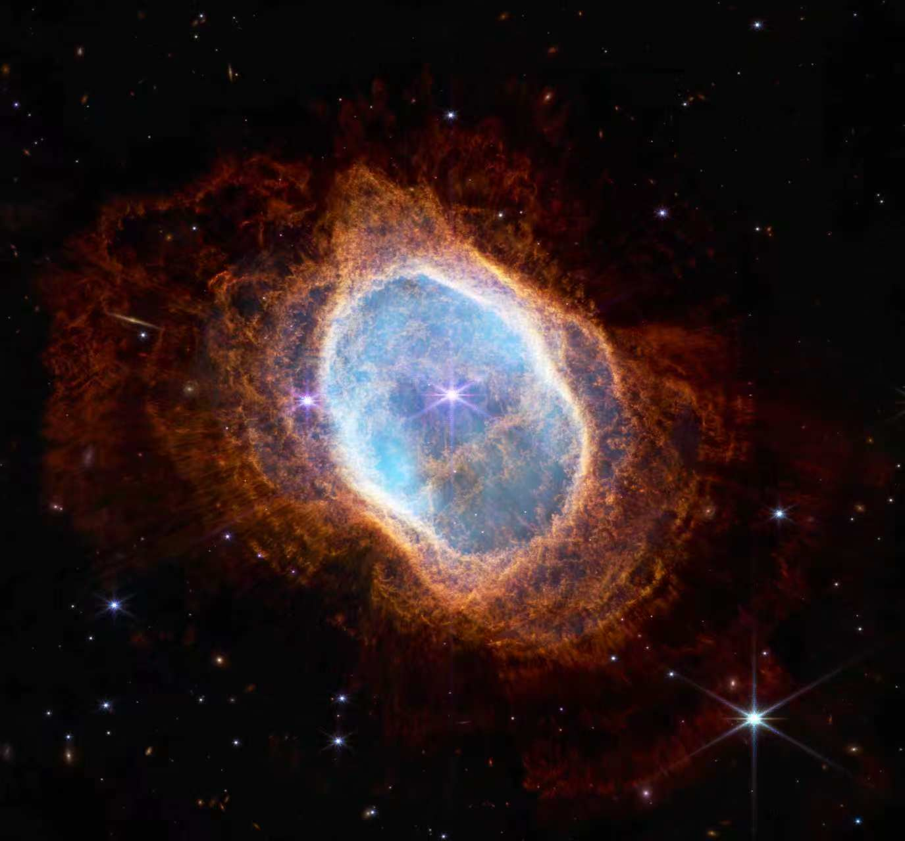

# Contributors

<!-- This page is generated from `contributors.yml` at the repository root.
     Lifetime activity is recorded in `tools/contributor_activity.json`.
     Edit the source data and run `python3 tools/generate_contributors.py` instead of
     editing the block below by hand. -->

  <button type="button" class="ap-lang-button" data-ap-set-lang="zh">中文</button>
  <button type="button" class="ap-lang-button" data-ap-set-lang="en">English</button>

<!-- CONTRIBUTORS:START -->

历史累计 · 截至 2026-11-25 · 统计说明

<strong>代码行数</strong> 从首次整库导入（c5308fa）之后起算，按 develop 非合并提交的作者累计新增行。计入算法源码、仓库内的 Markdown 和 reStructuredText 文档、docs/ 和 tests/ 下的文本文件，以及模块内的测试代码。SVG、生成文件和文本测试数据也计入。删除不抵扣，纯重命名计零行。

<strong>提交 PR</strong> 统计本人在 Gitee 发起、以 develop 为目标的全部 PR，含开放、关闭和已合并的 PR。

<strong>审阅／合并 PR</strong> 统计本人正式审阅通过或合并他人 PR 的数量。同一人对同一 PR 只计一次。自动合并按 Gitee 记录的操作者归属。

<strong>奖牌</strong> 每项的前三档正数依次获金、银、铜牌。并列同牌，零值不授牌。

<a href="https://gitee.com/algoplasma/algoplasma/commit/09ad2b674365b5841025d57290199cccde6936d5">develop · 09ad2b6</a> · <a href="https://gitee.com/algoplasma/algoplasma/pulls">Gitee PR 记录</a>

<h2 class="ap-contributor-heading">项目负责人</h2>
<table class="ap-work-list ap-work-list--lead">
  <thead>
    <tr>
      <th scope="col" align="left" width="160">成员</th>
      <th scope="col" align="left">个人简介</th>
    </tr>
  </thead>
  <tbody>
    <tr>
      <td class="ap-member" align="center" width="160" valign="top">
        

          
          

            <strong><a href="https://github.com/Yin-YinjianZhao">赵隐剑</a></strong> 
            项目负责人
             <small class="ap-member-links"><a href="https://homepage.hit.edu.cn/zhaoyinjian">个人主页</a> <a href="https://github.com/Yin-YinjianZhao">GitHub</a> <a href="https://gitee.com/Yin-YinjianZhao">Gitee</a></small>
          

        

      </td>
      <td class="ap-work-cell" valign="top">
        
哈尔滨工业大学副教授，曾在劳伦斯伯克利国家实验室从事博士后研究，获美国南加州大学航天工程博士学位。长期从事等离子体物理与数值模拟研究，研究方向涵盖空间电推进、核聚变、半导体、加速器、数值模拟算法及高性能并行计算等。

        
我希望在科研与教学的道路上，将 AlgoPlasma 作为一生耕耘的事业，服务于等离子体领域的科研、教育与产业，为这一领域的发展尽一份绵薄之力。

        
与大家共勉：

        <blockquote class="ap-member-quote">
“与其追求成功，不如努力成为一个有价值的人。” ——阿尔伯特·爱因斯坦
</blockquote>
        
代码行数 <b>488,262</b><i class="ap-medal" role="img" aria-label="代码行数 · 金牌" title="代码行数 · 金牌">🥇</i>提交 PR <b>5</b><i class="ap-medal" role="img" aria-label="提交 PR · 银牌" title="提交 PR · 银牌">🥈</i>审阅／合并 PR <b>3</b><i class="ap-medal" role="img" aria-label="审阅／合并 PR · 银牌" title="审阅／合并 PR · 银牌">🥈</i>

      </td>
    </tr>
  </tbody>
</table>
<h2 class="ap-contributor-heading">现任维护者</h2>
<table class="ap-maintainers">
  <tr>
    <td width="33.333%" valign="top">
      

        
        

          <strong><a href="https://gitee.com/HermiteCat">王佰胜</a></strong> 
          博士在读
           <small class="ap-member-links"><a href="https://gitee.com/HermiteCat">Gitee</a></small>
        

      

      

        
<strong>研究方向</strong> 空间电推进空心阴极实验及模拟

      

      
代码行数 <b>4,554</b>提交 PR <b>3</b><i class="ap-medal" role="img" aria-label="提交 PR · 铜牌" title="提交 PR · 铜牌">🥉</i>审阅／合并 PR <b>0</b>

    </td>
    <td width="33.333%" valign="top">
      

        
        

          <strong><a href="https://gitee.com/lzhe898">刘哲</a></strong> 
          博士在读
           <small class="ap-member-links"><a href="https://gitee.com/lzhe898">Gitee</a></small>
        

      

      

        
<strong>研究方向</strong> 光致电离、稠密等离子体焦点

      

      
代码行数 <b>84,889</b><i class="ap-medal" role="img" aria-label="代码行数 · 银牌" title="代码行数 · 银牌">🥈</i>提交 PR <b>1</b>审阅／合并 PR <b>2</b><i class="ap-medal" role="img" aria-label="审阅／合并 PR · 铜牌" title="审阅／合并 PR · 铜牌">🥉</i>

    </td>
    <td width="33.333%" valign="top">
      

        
        

          <strong><a href="https://github.com/GooseGH">赵中平</a></strong> 
          博士在读
           <small class="ap-member-links"><a href="https://github.com/GooseGH">GitHub</a> <a href="https://gitee.com/GooseGH">Gitee</a></small>
        

      

      

        
<strong>研究方向</strong> 霍尔推力器不稳定性实验及模拟

      

      
代码行数 <b>8,936</b>提交 PR <b>18</b><i class="ap-medal" role="img" aria-label="提交 PR · 金牌" title="提交 PR · 金牌">🥇</i>审阅／合并 PR <b>9</b><i class="ap-medal" role="img" aria-label="审阅／合并 PR · 金牌" title="审阅／合并 PR · 金牌">🥇</i>

    </td>
  </tr>
  <tr>
    <td width="33.333%" valign="top">
      

        
        

          <strong><a href="https://gitee.com/peng-zilong123">彭子龙</a></strong> 
          硕士在读
           <small class="ap-member-links"><a href="https://gitee.com/peng-zilong123">Gitee</a></small>
        

      

      

        
<strong>研究方向</strong> 等离子体波动实验诊断

      

      
代码行数 <b>16,435</b>提交 PR <b>2</b>审阅／合并 PR <b>0</b>

    </td>
    <td width="33.333%" valign="top">
      

        
        

          <strong><a href="https://gitee.com/Luo-Xin-410">罗鑫</a></strong> 
          博后在站
           <small class="ap-member-links"><a href="https://gitee.com/Luo-Xin-410">Gitee</a></small>
        

      

      

        
<strong>研究方向</strong> 霍尔推力器电子反常传导

      

      
代码行数 <b>9,051</b>提交 PR <b>1</b>审阅／合并 PR <b>0</b>

    </td>
    <td width="33.333%" valign="top">
      

        
        

          <strong><a href="https://orcid.org/0009-0009-6248-9781">谢礼桓</a></strong> 
          博士在读
           <small class="ap-member-links"><a href="https://orcid.org/0009-0009-6248-9781">ORCID</a></small>
        

      

      

        
<strong>研究方向</strong> 碘工质霍尔推力器不稳定性

      

      
代码行数 <b>0</b>提交 PR <b>0</b>审阅／合并 PR <b>0</b>

    </td>
  </tr>
  <tr>
    <td width="33.333%" valign="top">
      

        
        

          <strong>陈曦</strong> 
          博士在读
        

      

      

        
<strong>研究方向</strong> 三维PIC加速方法及降维模型

      

      
代码行数 <b>0</b>提交 PR <b>0</b>审阅／合并 PR <b>0</b>

    </td>
    <td width="33.333%" valign="top">
      

        
        

          <strong><a href="https://gitee.com/jiaohuadetudouni">陈英杰</a></strong> 
          博士在读
           <small class="ap-member-links"><a href="https://gitee.com/jiaohuadetudouni">Gitee</a></small>
        

      

      

        
<strong>研究方向</strong> 柱坐标PIC算法优化

      

      
代码行数 <b>55,718</b><i class="ap-medal" role="img" aria-label="代码行数 · 铜牌" title="代码行数 · 铜牌">🥉</i>提交 PR <b>5</b><i class="ap-medal" role="img" aria-label="提交 PR · 银牌" title="提交 PR · 银牌">🥈</i>审阅／合并 PR <b>0</b>

    </td>
    <td width="33.333%" valign="top">
      

        
        

          <strong>钟昆硼</strong> 
          硕士在读
        

      

      

        
<strong>研究方向</strong> 霍尔推力器磁聚焦机理

      

      
代码行数 <b>0</b>提交 PR <b>0</b>审阅／合并 PR <b>0</b>

    </td>
  </tr>
  <tr>
    <td width="33.333%" valign="top">
      

        
        

          <strong><a href="https://gitee.com/HIT-ZhouZhijun">周志君</a></strong> 
          博士在读
           <small class="ap-member-links"><a href="https://gitee.com/HIT-ZhouZhijun">Gitee</a></small>
        

      

      

        
<strong>研究方向</strong> 霍尔推力器周向非均匀及不稳定性

      

      
代码行数 <b>0</b>提交 PR <b>0</b>审阅／合并 PR <b>0</b>

    </td>
    <td width="33.333%" valign="top">
      

        
        

          <strong>张武顺</strong> 
          博士在读
        

      

      

        
<strong>研究方向</strong> 高超声速飞行器电子发汗冷却

      

      
代码行数 <b>2,201</b>提交 PR <b>1</b>审阅／合并 PR <b>0</b>

    </td>
    <td width="33.333%" valign="top">
      

        
        

          <strong><a href="https://github.com/darlingdefender">胡长征</a></strong> 
          硕士在读
           <small class="ap-member-links"><a href="https://github.com/darlingdefender">GitHub</a> <a href="https://gitee.com/hu-changzheng1">Gitee</a></small>
        

      

      

        
<strong>研究方向</strong> 等离子体波动理论

      

      
代码行数 <b>6</b>提交 PR <b>1</b>审阅／合并 PR <b>0</b>

    </td>
  </tr>
</table>

Lifetime totals · through 2026-11-25 · How we count

<strong>Code lines</strong> Additions by author in non-merge commits on develop after the initial import (c5308fa). Counts include algorithm source, Markdown and reStructuredText across the repository, text files in docs/ and tests/, and tests within modules. SVGs, generated files and text test data count. Deletions do not reduce the total and pure renames add no lines.

<strong>PRs opened</strong> All Gitee PRs the contributor opened against develop, including open, closed and merged PRs.

<strong>PRs reviewed/merged</strong> PRs by other authors that the contributor formally approved or merged. Each PR counts once per person. Automatic merges are credited to the account recorded by Gitee.

<strong>Medals</strong> Gold, silver and bronze mark the three highest distinct positive values in each metric. Ties share a medal.

<a href="https://gitee.com/algoplasma/algoplasma/commit/09ad2b674365b5841025d57290199cccde6936d5">develop · 09ad2b6</a> · <a href="https://gitee.com/algoplasma/algoplasma/pulls">Gitee pull requests</a>

<h2 class="ap-contributor-heading">Project Lead</h2>
<table class="ap-work-list ap-work-list--lead">
  <thead>
    <tr>
      <th scope="col" align="left" width="160">Member</th>
      <th scope="col" align="left">Biography</th>
    </tr>
  </thead>
  <tbody>
    <tr>
      <td class="ap-member" align="center" width="160" valign="top">
        

          
          

            <strong><a href="https://github.com/Yin-YinjianZhao">Yinjian Zhao</a></strong> 
            Project Lead
             <small class="ap-member-links"><a href="https://homepage.hit.edu.cn/zhaoyinjian">Homepage</a> <a href="https://github.com/Yin-YinjianZhao">GitHub</a> <a href="https://gitee.com/Yin-YinjianZhao">Gitee</a></small>
          

        

      </td>
      <td class="ap-work-cell" valign="top">
        
I am an Associate Professor at Harbin Institute of Technology. I conducted postdoctoral research at Lawrence Berkeley National Laboratory and earned my PhD in Astronautical Engineering from the University of Southern California. My research has long focused on plasma physics and numerical simulation, spanning space electric propulsion, nuclear fusion, semiconductors, accelerators, numerical simulation algorithms, and high-performance parallel computing.

        
Throughout my career in research and teaching, I hope to make AlgoPlasma a lifelong endeavor, serving the plasma community across research, education, and industry, and contributing in my own small way to the field's progress.

        
A thought to share:

        <blockquote class="ap-member-quote">
Try to become not a man of success, but try rather to become a man of value. — Albert Einstein
</blockquote>
        
Code lines <b>488,262</b><i class="ap-medal" role="img" aria-label="Code lines · Gold" title="Code lines · Gold">🥇</i>PRs opened <b>5</b><i class="ap-medal" role="img" aria-label="PRs opened · Silver" title="PRs opened · Silver">🥈</i>PRs reviewed/merged <b>3</b><i class="ap-medal" role="img" aria-label="PRs reviewed/merged · Silver" title="PRs reviewed/merged · Silver">🥈</i>

      </td>
    </tr>
  </tbody>
</table>
<h2 class="ap-contributor-heading">Current Maintainers</h2>
<table class="ap-maintainers">
  <tr>
    <td width="33.333%" valign="top">
      

        
        

          <strong><a href="https://gitee.com/HermiteCat">Baisheng Wang</a></strong> 
          PhD Student
           <small class="ap-member-links"><a href="https://gitee.com/HermiteCat">Gitee</a></small>
        

      

      

        
<strong>Research Interests</strong> Experiments and simulations of hollow cathodes for space electric propulsion

      

      
Code lines <b>4,554</b>PRs opened <b>3</b><i class="ap-medal" role="img" aria-label="PRs opened · Bronze" title="PRs opened · Bronze">🥉</i>PRs reviewed/merged <b>0</b>

    </td>
    <td width="33.333%" valign="top">
      

        
        

          <strong><a href="https://gitee.com/lzhe898">Zhe Liu</a></strong> 
          PhD Student
           <small class="ap-member-links"><a href="https://gitee.com/lzhe898">Gitee</a></small>
        

      

      

        
<strong>Research Interests</strong> Photoionization and dense plasma focus

      

      
Code lines <b>84,889</b><i class="ap-medal" role="img" aria-label="Code lines · Silver" title="Code lines · Silver">🥈</i>PRs opened <b>1</b>PRs reviewed/merged <b>2</b><i class="ap-medal" role="img" aria-label="PRs reviewed/merged · Bronze" title="PRs reviewed/merged · Bronze">🥉</i>

    </td>
    <td width="33.333%" valign="top">
      

        
        

          <strong><a href="https://github.com/GooseGH">Zhongping Zhao</a></strong> 
          PhD Student
           <small class="ap-member-links"><a href="https://github.com/GooseGH">GitHub</a> <a href="https://gitee.com/GooseGH">Gitee</a></small>
        

      

      

        
<strong>Research Interests</strong> Experiments and simulations of instabilities in Hall thrusters

      

      
Code lines <b>8,936</b>PRs opened <b>18</b><i class="ap-medal" role="img" aria-label="PRs opened · Gold" title="PRs opened · Gold">🥇</i>PRs reviewed/merged <b>9</b><i class="ap-medal" role="img" aria-label="PRs reviewed/merged · Gold" title="PRs reviewed/merged · Gold">🥇</i>

    </td>
  </tr>
  <tr>
    <td width="33.333%" valign="top">
      

        
        

          <strong><a href="https://gitee.com/peng-zilong123">Zilong Peng</a></strong> 
          Master&#x27;s Student
           <small class="ap-member-links"><a href="https://gitee.com/peng-zilong123">Gitee</a></small>
        

      

      

        
<strong>Research Interests</strong> Experimental diagnostics of plasma waves

      

      
Code lines <b>16,435</b>PRs opened <b>2</b>PRs reviewed/merged <b>0</b>

    </td>
    <td width="33.333%" valign="top">
      

        
        

          <strong><a href="https://gitee.com/Luo-Xin-410">Xin Luo</a></strong> 
          Postdoctoral Researcher
           <small class="ap-member-links"><a href="https://gitee.com/Luo-Xin-410">Gitee</a></small>
        

      

      

        
<strong>Research Interests</strong> Anomalous electron transport in Hall thrusters

      

      
Code lines <b>9,051</b>PRs opened <b>1</b>PRs reviewed/merged <b>0</b>

    </td>
    <td width="33.333%" valign="top">
      

        
        

          <strong><a href="https://orcid.org/0009-0009-6248-9781">Lihuan Xie</a></strong> 
          PhD Student
           <small class="ap-member-links"><a href="https://orcid.org/0009-0009-6248-9781">ORCID</a></small>
        

      

      

        
<strong>Research Interests</strong> Instabilities in iodine-propellant Hall thrusters

      

      
Code lines <b>0</b>PRs opened <b>0</b>PRs reviewed/merged <b>0</b>

    </td>
  </tr>
  <tr>
    <td width="33.333%" valign="top">
      

        
        

          <strong>Xi Chen</strong> 
          PhD Student
        

      

      

        
<strong>Research Interests</strong> Acceleration methods for 3D PIC simulations and reduced-dimensional models

      

      
Code lines <b>0</b>PRs opened <b>0</b>PRs reviewed/merged <b>0</b>

    </td>
    <td width="33.333%" valign="top">
      

        
        

          <strong><a href="https://gitee.com/jiaohuadetudouni">Yingjie Chen</a></strong> 
          PhD Student
           <small class="ap-member-links"><a href="https://gitee.com/jiaohuadetudouni">Gitee</a></small>
        

      

      

        
<strong>Research Interests</strong> Optimization of PIC algorithms in cylindrical coordinates

      

      
Code lines <b>55,718</b><i class="ap-medal" role="img" aria-label="Code lines · Bronze" title="Code lines · Bronze">🥉</i>PRs opened <b>5</b><i class="ap-medal" role="img" aria-label="PRs opened · Silver" title="PRs opened · Silver">🥈</i>PRs reviewed/merged <b>0</b>

    </td>
    <td width="33.333%" valign="top">
      

        
        

          <strong>Kunpeng Zhong</strong> 
          Master&#x27;s Student
        

      

      

        
<strong>Research Interests</strong> Magnetic focusing mechanisms in Hall thrusters

      

      
Code lines <b>0</b>PRs opened <b>0</b>PRs reviewed/merged <b>0</b>

    </td>
  </tr>
  <tr>
    <td width="33.333%" valign="top">
      

        
        

          <strong><a href="https://gitee.com/HIT-ZhouZhijun">Zhijun Zhou</a></strong> 
          PhD Student
           <small class="ap-member-links"><a href="https://gitee.com/HIT-ZhouZhijun">Gitee</a></small>
        

      

      

        
<strong>Research Interests</strong> Azimuthal nonuniformity and instabilities in Hall thrusters

      

      
Code lines <b>0</b>PRs opened <b>0</b>PRs reviewed/merged <b>0</b>

    </td>
    <td width="33.333%" valign="top">
      

        
        

          <strong>Wushun Zhang</strong> 
          PhD Student
        

      

      

        
<strong>Research Interests</strong> Electron transpiration cooling of hypersonic vehicles

      

      
Code lines <b>2,201</b>PRs opened <b>1</b>PRs reviewed/merged <b>0</b>

    </td>
    <td width="33.333%" valign="top">
      

        
        

          <strong><a href="https://github.com/darlingdefender">Changzheng Hu</a></strong> 
          Master&#x27;s Student
           <small class="ap-member-links"><a href="https://github.com/darlingdefender">GitHub</a> <a href="https://gitee.com/hu-changzheng1">Gitee</a></small>
        

      

      

        
<strong>Research Interests</strong> Theory of plasma waves

      

      
Code lines <b>6</b>PRs opened <b>1</b>PRs reviewed/merged <b>0</b>

    </td>
  </tr>
</table>

<!-- CONTRIBUTORS:END -->

<!-- 2026-11-25 10:07 +0800 | Yinjian Zhao (Codex-assisted) -->
