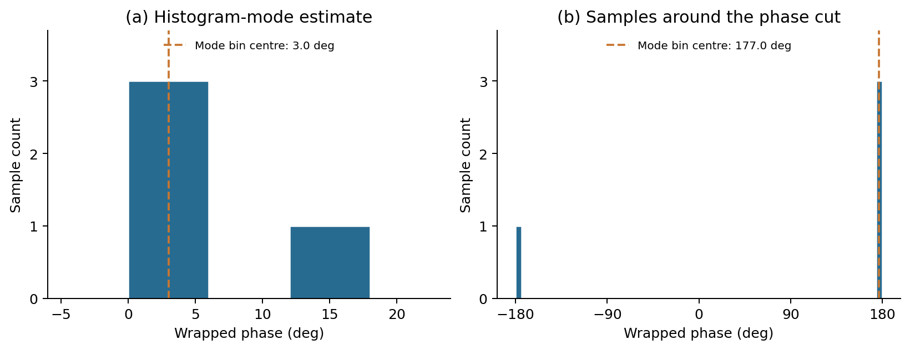
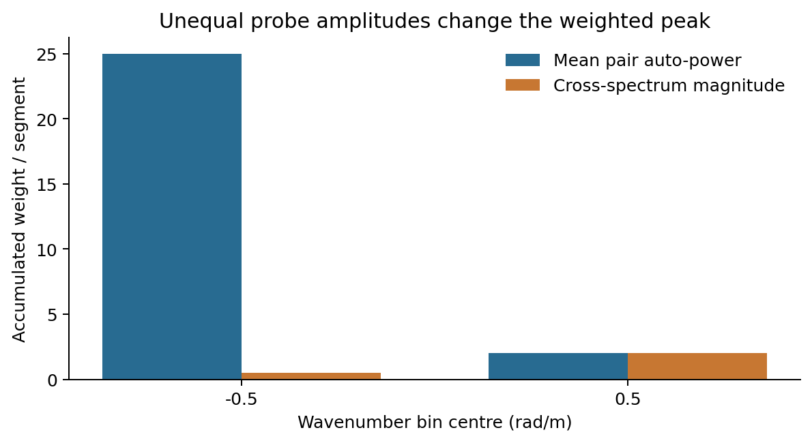
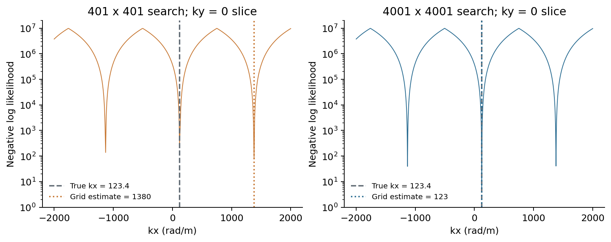
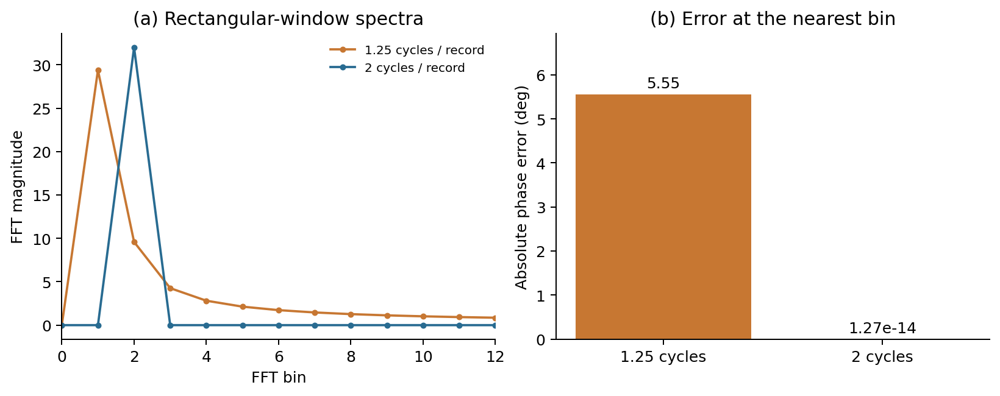

Basic and Boundary-Condition Checks
=====================================

.. raw:: html

   

     <button type="button" class="ap-lang-button" data-ap-set-lang="zh">中文</button>
     <button type="button" class="ap-lang-button" data-ap-set-lang="en">English</button>
   

.. container:: ap-lang ap-lang-zh

   .. rubric:: 这组测试检查什么？

   这 12 项测试从已知输入出发，逐项检查相位统计、Beall 权重、波矢搜索及输入条件。
   例如，两路幅值不同的 FFT 样本用来检验功率权重；已知波矢和基线用来检验网格搜索。
   每项结果给出输入、参考量、实际值、比较规则和状态，配图读取同次运行保存的数组。

   .. rubric:: 运行与文件

   从仓库根目录运行：

   .. code-block:: bash

      bash tests/010_diagnostics/case_basic_checks/run.sh

   ``source_py/test_regressions.py`` 定义输入和断言，``report.py`` 写出结果，
   ``plot_results.py`` 读取保存的数组绘图。结果在 ``output/summary.json``，
   数值数组在 ``output/details/``，PNG 在 ``output/figures/``。
   运行失败时 summary.json 仍记录已执行的检查及错误。clean.sh 清理运行输出。

   更新本页的结果快照：

   .. code-block:: bash

      bash tests/010_diagnostics/case_basic_checks/run.sh --publish-docs

   快照包含报告、绘图数据、PNG、运行时间及代码 SHA-256。
   :download:`完整数值报告 <_generated/case_basic_checks/summary.json>` 与
   :download:`运行来源 <_generated/case_basic_checks/provenance.json>` 可下载核对。
   Sphinx 直接读取快照，网页构建与数值计算分开进行。

   .. rubric:: 怎样读结果

   “实际”是函数返回值或由它计算的误差；“参考或界限”是已知答案或比较边界。
   相等性检查列出最大绝对差，不等式检查直接按表中的方向比较。
   NaN 表示未定义或缺失的数值。功率积分检查使用离散 Parseval 关系。
   这些确定性构造各运行一次；相位直方图使用 4 个样本，窗口功率检查使用固定种子的 4 段记录。

   网格分辨率案例包含 401 点与 4001 点两次独立完整搜索。
   该几何在 401 点时选择另一个混叠分支、4001 点时接近已知波矢；
   表中的“大于 1000 rad/m”检查用来确认这个构造确实呈现分辨率差异。

.. container:: ap-lang ap-lang-en

   .. rubric:: What do these checks examine?

   Twelve small known-input cases examine phase statistics, Beall weights, wavevector search
   and input conditions. Unequal-amplitude FFT samples test the weight definition;
   known wavevectors and baselines test grid search. Each result lists inputs, references,
   measurements, criteria and status. Figures read arrays from the same run.

   .. rubric:: Running and files

   From the repository root:

   .. code-block:: bash

      bash tests/010_diagnostics/case_basic_checks/run.sh

   source_py/test_regressions.py defines inputs and assertions; report.py writes the report;
   plot_results.py plots the saved arrays. summary.json, details/ and figures/ are under output/.
   Failures are recorded in summary.json. clean.sh removes runtime output.
   Use ``--publish-docs`` to publish a successful run's report, arrays, PNGs and source hashes together.

   :download:`Download the numerical report <_generated/case_basic_checks/summary.json>` and
   :download:`provenance <_generated/case_basic_checks/provenance.json>`.
   Sphinx reads this snapshot independently of numerical execution.

   .. rubric:: Reading the results

   Actual values are function outputs or derived errors. References are known answers or bounds.
   Equality checks report maximum absolute differences; inequality checks use the stated direction.
   NaN marks undefined or missing values. Integrated PSD is checked using discrete Parseval.
   Each deterministic construction runs once; phase histograms contain four samples and
   window-power checks use four records with a fixed random seed.

   The resolution case performs separate full searches with 401 and 4001 points per axis.
   For this geometry, the 401-point estimate selects another alias while 4001 points approach
   the known wavevector. The greater-than-1000-rad/m check confirms the constructed resolution contrast.

.. include:: _generated/case_basic_checks/results.rst
   :start-after: .. result-table

.. rubric:: 解释图 / Explanatory figures

   **图 1 / Figure 1. 相位分箱 / Phase bins.** 每图 4 个输入相位、60 格直方图，虚线为计算得到的众数格中心。
   左图显示格中心与样本位置的关系；右图的 ±180° 对应同一角度边界。
   Four samples and 60 bins per panel; dashed lines mark the computed modal bin centres.

   **图 2 / Figure 2. 功率权重 / Power weights.** 两段 FFT 幅值分别为 (10, 0.1) 和 (2, 2)，
   相位为 −0.5 和 0.5 rad，基线长度为 1 m。纵轴为两段平均后的格权重。
   蓝色采用两路自功率平均，橙色采用互谱幅值，峰的位置随权重定义改变。
   Two FFT-amplitude pairs, (10, 0.1) and (2, 2), populate separate phase bins.
   Bars show weights averaged over the two segments for the two definitions.

   **图 3 / Figure 3. 网格采样 / Grid sampling.** 真值 (123.4, 0) rad/m；四条基线沿两坐标轴，长度 5 和 5.01 mm。
   两幅图分别显示完整二维搜索所用网格在 ky=0 处的截面，纵轴为负对数似然（对数刻度）。
   虚线标记真值，点线标记各次二维搜索的估计 kx。截面曲线用于展示网格采样，估计来自二维遍历。
   Slices at ky=0 illustrate sampling on each grid; marked estimates come from the full 2D searches.

   **图 4 / Figure 4. 记录长度与相位 / Record length and phase.** 两路无噪声余弦相位差为 0.8 rad，每段 64 点，
   去均值后使用矩形窗。左图为第一路 FFT 幅值（展示 bin 0–12），右图为最近频点的互相位绝对误差。
   两种记录分别含 1.25 和 2 个周期。Two noiseless 64-sample records with a 0.8-rad phase difference;
   spectra use detrending and a boxcar window. The right panel shows the measured nearest-bin phase errors.
