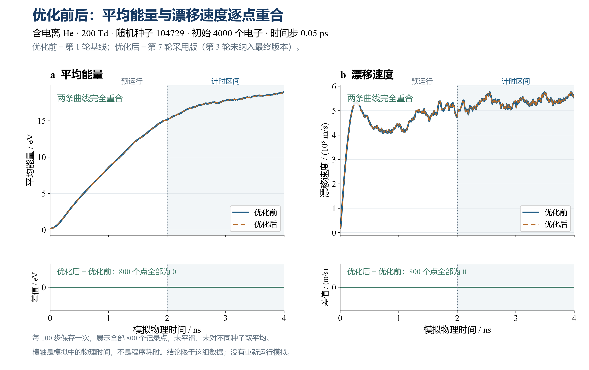

# MCC 并行与性能

## 为什么测这九个工况

G02 是 AlgoPlasma 用于抽样计算粒子碰撞的模块。最初，我们让一群电子在均匀外电场中运动，与背景气体碰撞，用另一套等离子体模拟程序 WarpX 做对照。在相同初始粒子数、步长和单线程条件下，九个工况中旧 G02 每秒完成的时间步都少于 WarpX。为弄清耗时在哪里，我们对 G02 的粒子读取、排序和碰撞循环分别计时，再逐轮减少重复工作。每轮都用相同输入比较改动前后的输出。

下表中 Td 是约化电场 E/N 的单位，E 为电场强度，N 为背景中性气体数密度。最后一列给出最初那批运行的 WarpX 步速除以旧 G02 步速，三个数按场强顺序排列。例如 1.717 表示同一秒内 WarpX 完成的步数是当时 G02 的 1.717 倍。每次从 4,000 个电子开始，步长 0.05 ps，先运行 50,000 步，再计时 50,000 步（2.5–5 ns）。

| 气体和碰撞过程 | 约化电场（Td） | 工况的由来与用途 | 最初 WarpX / G02 步速比 |
|---|---|---|---|
| He，关闭电离 | 20、50、200 | 保留弹性散射和两条激发通道。三档场强由本研究选取，用于观察电子不因电离增殖时的运行成本。 | 1.502、1.502、1.501 |
| He，开启电离 | 20、50、200 | 在相同 He 截面和三档场强下加入电离通道。200 Td 在原测速窗口中实际产生了新电子，可以考察粒子数控制带来的工作。 | 1.318、1.320、1.717 |
| Reid-ramp 模型气体 | 1、12、24 | 采用恒定弹性截面和从 0.2 eV 阈值起线性增加的激发截面。这三档场强与 Dias 等的 Table 1 一致，有公开数值可对照。 | 1.265、1.260、1.263 |

He 的四张原始电子碰撞截面表已逐文件核对，与 [WarpX 数据仓库所列版本](https://github.com/BLAST-WarpX/warpx-data/tree/b59a35f8d2d10592b2ea0ea18608dc2a12bc1380/MCC_cross_sections/He) 一致，其 README 将来源列为 S. F. Biagi 的 MAGBOLTZ 7.1。该来源提供截面，本研究选取 He 的场强。Reid 的模型定义与三个场强见 [Dias 等，Computer Physics Communications 282 (2023), 108554，Table 1](https://doi.org/10.1016/j.cpc.2022.108554)。

七轮试验后，我们把保留的改动合到一版 G02。为回答“这次改动本身快了多少”，本 PR 从三组各取一个代表：He 无电离 50 Td 看固定粒子数，He 含电离 200 Td 看有新电子时的工作，Reid 12 Td 看模型气体的中间场强。配对测速的两方改为上游 develop 与本 PR 的 G02，测量窗口为 2–4 ns。本文末尾的命令可重跑这三个工况。

## 改动前后，哪些输出一致？

G02 用随机抽样决定一个时间步内哪些粒子发生碰撞。我们希望减少处理每个粒子所需的时间，同时让同一组输入得到相同的碰撞输出。一个例子是，电子的首个候选碰撞要等 0.20 ps 才出现，而当前步长只有 0.05 ps。此时可以直接处理下一个电子。若候选在本步之内，程序会把已经抽出的等待时间交给碰撞内核。



**图 1（历史七轮试验中的一个例子）。** 含电离 He，200 Td，种子 104729。蓝实线是第一轮改动前，橙虚线是第七轮采用版。两版从同一批电子开始。横轴是模拟时间；左图看平均能量，右图看漂移速度。每 100 步记录一次，从 0.005 ns 到 4 ns 共 800 点，其中 2–4 ns 用于计时。对同一个量逐点比较两版，最大绝对差分别为 0 eV 和 0 m/s。[查看本图的 800 行数据](he200_replay.csv)

**完整核对看什么？** 例如，在开启电离的 He 200 Td 算例中，给当轮基线和试改版相同的初始电子和种子，各跑一次，就构成一对。先比较过程 CSV 的全部记录，再比较最终粒子状态文件的每个字节。每轮都按这个方法核对九个工况、每个工况三个种子；七轮合计 189 对，全部相同。图 1 展示第一轮基线到第七轮采用版的一个工况，供读者看平均能量和漂移速度随时间的变化。针对实际提交的 G02，我们另用三个代表工况与原 develop 配对：除诊断文件外，还逐粒子核对最终位置、三方向速度、编号等字段，并比较候选碰撞数、真实碰撞数和电离新生电子数。这里的一致性结论适用于这些算例记录的输出。

**优化后，同样的 40,000 步少用了多少时间？** 下表是首次主测：两版在同一台机器上各用一个 CPU 线程，先走 40,000 步，再计时 40,000 步（2–4 ns）。每个工况用三份初始输入，原版与优化版逐份配对。表中秒数是三次的平均值，加速比用未舍入的总用时计算。

下表对应上游 `7db6abe` 与首次测速版 `7ecac28`。后续的缓存重试和浮点边界修复没有参与这批计时。

| 工况 | 原版 G02 | 优化版 G02 | 加速比 |
|---|---:|---:|---:|
| He 关闭电离，50 Td | 15.205 s | 4.657 s | 3.26 倍 |
| He 开启电离，200 Td | 19.860 s | 4.617 s | 4.30 倍 |
| Reid 模型气体，12 Td | 16.083 s | 4.756 s | 3.38 倍 |

**边界修复后又核对了什么？** 我们用种子 104729，把上表的三个工况各完整重跑一对（上游版与修复版，仍为 2–4 ns 单线程计时）。每对的过程记录和最终粒子状态都逐字节相同，也与此前同一种子的对应输出一致。[查看三对修复后记录](review_replay.csv)：每行列出版本、秒数、内存、碰撞计数和两份一致文件各自的 SHA-256 校验值。这批只用一个种子，没有混入上表的三种子平均值。

**修复本身是否增加了用时？** 另用同样的单线程设置，直接比较已经优化的 G02 修复前（`c9f01cf`）和修复后（`f3ffde8`）。按上表顺序，三个种子的主测总用时分别增加 7.6%、3.3%、0.1%；用第一个种子交换顺序再测，分别减少 1.7%、13.4%、2.5%。12 对运行的过程文件、最终粒子状态和碰撞计数均相同。这批数据没有给出跨工况稳定的开销比例。[修复前后的逐对秒数](safeguard_timings.csv)中，`baseline_s` 和 `candidate_s` 分别是修复前和修复后用时，`main` 为主测，`reverse` 为交换顺序复测。

[直接看最初九个工况的用时：旧 G02 与 WarpX](warpx_runs.csv)；[直接看本次三工况的逐对用时：原版与优化版 G02](timings.csv)。前一张表每行是一次运行，`seconds` 是走完 `steps` 个计时步实际花的秒数。若要连同原始输出一起核对，[下载完整核对数据](benchmark_evidence.tar.xz)，解压后运行 `python3 verify.py`：

| 想核对什么 | 文件和读法 |
|---|---|
| 为什么开始优化？ | `warpx_runs.csv` 每行对应一次早期运行。每个工况、每套程序各跑三次，计时步数相同；用 G02 的总秒数除以 WarpX 的总秒数，可得到上文的 WarpX/G02 步速比。 |
| 现在到底快了多少？ | `timings.csv` 给出两版每一次的计时。筛选 first（原批次）、main（主测）及一个工况；两列分别求和再相除就是表中的加速比。repeat 是另一批独立复测，reverse 是交换运行顺序的补测。 |
| 记录的输出是否一致？ | `history/pairs.csv` 一行对应七轮试验中的一对原始输出；`timings/` 保存本次两个测速批次的两版输出。脚本直接比较过程文件和最终粒子状态文件。 |
| 模块测试与弹性碰撞盒检查了什么？ | `checks/ctest.log` 列出测试名称及结果；`checks/before/` 和 `checks/after/` 是碰撞盒两版的逐步记录、分布和碰撞计数。 |

以关闭电离的 He 50 Td 为例，首次主测中原版三次共用 45.615712 s，优化版三次共用 13.971234 s。两者相除得到 3.26497，保留两位小数是 3.26 倍；耗时减少量除以原版用时为 69.37%。计算使用未舍入的记录，表格为便于阅读显示到三位小数。

批量入口可以复用上一时间步的粒子访问顺序。代码先核对数量、各位置的 ID
及存活状态，失序且原索引失效时重新排序。连续粒子容器整批复制到独立快照，
随后仍逐个检查粒子。相邻粒子的物种和状态相同时复用定义查找。

在同一步的已验证快照内，私有碰撞入口复用输入检查结果。相同种子和时间步的
随机数整数前缀可以复用，各粒子的 ID、事件号和用途号仍参与计算。首个候选
在步外时省去碰撞对象准备。在步内时将同一次抽样传给内核。等待时间快速判断
仅在有足够数值余量时排除候选，其余情况沿用完整对数公式。

七轮试验中采用了六轮改动。第三轮尝试预计算事件号为零时的部分运算，因速度收益不稳定而未采用。

历史测速使用单线程和一个 MPI 进程，初始 4000 个电子，时间步 0.05 ps，
预运行和计时各 40000 步。这些记录描述该电子群驱动的有限时间窗口。
多核并行速度需要在相应粒子规模和并行配置下测量。

建议每个 PIC 时间步只调用一次批量 MCC，并跨步保留工作区。MPI（消息传递接口）
按宿主已有的粒子分区运行，OpenMP（共享内存并行）处理每个 rank 的本地粒子。
两者可以同时启用；MCC 不接管粒子迁移、网格划分或背景演化。

## 接入方式

```cpp
#include "mpi.hpp"

// 宿主先 MPI_Init_thread(..., MPI_THREAD_FUNNELED, ...)。
StepOptions options;
options.backend = CpuBackend::OpenMp;
options.threads = 4;
DistributedMccStepper mcc(engine, MPI_COMM_WORLD, options);
VectorParticleAdapter adapter(local_particles);
for (std::uint64_t step = 0; step < steps; ++step) {
    StepReport local_report = mcc.step(adapter, local_background, dt_s, step, seed);
    apply_local_sources(local_report.reservoir);
}
// 所有 rank 在 MPI_Finalize() 之前销毁 mcc。
```

不用 MPI 时，创建一次 `MccWorkspace workspace`，循环里调用
`stepper.step(adapter, background, dt, step, seed, workspace)`。不带工作区的重载
仍可用，但每步会重新分配临时缓冲区。

每个 rank 都调用 `DistributedMccStepper::step()`。粒子 ID 必须全局唯一；宿主迁移
粒子时保留 ID。每次调用返回本 rank 的报告，跨 rank 的源项汇总由宿主决定。
新产物 ID 按 `(parent_id, event_index, product_ordinal)` 的全局顺序分配，与粒子
落在哪个 rank 或线程无关。一个 rank 的准备或容量检查失败时，所有 rank 在提交
前退出，本步粒子不变。MPI 调用必须在主线程执行，线程支持至少为
`MPI_THREAD_FUNNELED`；步进器应在 `MPI_Finalize()` 前销毁。

工作区和适配器均不支持并发重入；一个粒子群保留稳定的 ID 高水位。

## 已实现的优化

- 活动通道按模型、背景、空间单元、物种、状态和采样选项缓存；背景数值变化时
  自动失效。相邻同键粒子复用查找结果；零密度通道做精确剪枝。
- 粒子快照、工作块和通道表跨步复用。已按 ID 排序的输入跳过排序；无出生/删除
  的提交直接原位更新，避免全量重建和更新数组复制。
- 多通道可选别名采样器（alias sampler，常数时间选通道）；默认前缀采样器。
  只有在目标负载的整步计时稳定快于默认方案至少 5% 时才建议启用。
- MPI 仅交换产物 ID 的元数据，不传输正常碰撞粒子；无产物时跳过路由通信。
  本地准备和提交前检查通过集体通信协调，保持整步失败原子性。

## 构建与测量

```bash
cmake -S tests/009_collision/G02_MCC_network -B /tmp/g02_mcc_hybrid -DCMAKE_BUILD_TYPE=Release \
  -DG02_MCC_ENABLE_MPI=ON -DG02_MCC_ENABLE_OPENMP=ON
cmake --build /tmp/g02_mcc_hybrid -j 4
ctest --test-dir /tmp/g02_mcc_hybrid --output-on-failure
/tmp/g02_mcc_hybrid/bench_batch 1000000 100 5 32 prefix
/tmp/g02_mcc_hybrid/bench_batch 1000000 100 5 32 alias
/tmp/g02_mcc_hybrid/g02_generate_test_data /tmp/g02_mcc_hybrid/generated_models
mpirun -n 4 /tmp/g02_mcc_hybrid/mpi_collision_box \
  /tmp/g02_mcc_hybrid/generated_models/collision_box_elastic 1000000 5 4
```

下表是上游此前在 32 个物理核上的并行基准记录，测量的是 MCC 碰撞步骤。当前 PR 的电子群加速比来自前述三个代表工况的单线程复测。下表使用 Release 构建和 OpenMPI 4.1.6，预热 2 至 3 次后取 5 次测量的中位数。

| 负载 | 配置 | 整步时间 |
| --- | --- | ---: |
| 100 万粒子、100 通道 | 1 线程、前缀 | 1.003 s |
| 同上 | 32 线程、前缀 | 0.110 s |
| 同上 | 32 线程、别名 | 0.105 s |
| 100 万粒子、1 通道碰撞盒 | 1 rank x 1 线程 | 0.288 s |
| 同上 | 2 rank x 1 线程 | 0.130 s |
| 同上 | 4 rank x 1 线程 | 0.068 s |
| 同上 | 4 rank x 4 线程 | 0.029 s |

100 通道基准的旧实现此前约为 0.365 s（32 线程）；当时跨步工作区版本约为
0.110 s。别名采样在这次并行测试里不到 5% 的整步收益，故保持前缀为默认。
MPI 行使用不同的单通道模型，只用于比较同一模型的 rank/thread 扩展，不应和
100 通道行直接比较。基准只测 MCC 整步，不含 Poisson、电荷沉积、电场、位置
推进或壁面；真实 PIC 的最终加速比还取决于它们及宿主粒子分区。

## 复现三个电子群工况的配对测速

在 Linux 或 WSL2 的完整 Git 检出中，从仓库根目录执行下列命令。需要 Python 3、Git、CMake ≥ 3.20、支持 C++20 与 OpenMP 的 G++、MPI 开发库和 `taskset`。脚本单独构建上游基线 `7db6abe` 与当前 `HEAD` 的 G02，给两版链接同一份 [电子群驱动](examples/swarm_benchmark/swarm.cpp)。输出目录必须是新目录。

```sh
bench=tests/009_collision/G02_MCC_network/examples/swarm_benchmark/run.py
python3 "$bench" --smoke --out ../swarm-smoke
python3 "$bench" --out ../swarm-full
```

第一条命令用三个工况各跑一对短算例来检查安装。第二条命令对 He 关闭电离 50 Td、He 开启电离 200 Td 和 Reid 模型气体 12 Td 各跑三个种子（104729、130363、155921），再对每个工况的第一个种子交换运行顺序复测，共 12 对。若要严格指定逻辑 CPU，可加 `--cpu 2`（原测速使用 CPU 2）。要对照 PR 表格的确切源码，可加 `--candidate 7ecac28`。不同机器的耗时会有差异。

两版从相同的 4,000 个电子开始，采用均匀外场和 0.05 ps 时间步，每 100 步做粒子数控制和诊断。各预运行 40,000 步，计时后续 40,000 步（2–4 ns），计时包含 CSV 刷新。每对须通过过程 CSV、最终粒子状态逐字节比较及碰撞计数检查。输出目录的 `pairs.csv` 记录每对的顺序、耗时和峰值内存，`runs/` 保存可核对的原始结果。每个工况的加速比用三次主测的基线总用时除以候选总用时，反序复测单列。

[固定输入](examples/swarm_benchmark/swarm_inputs.zip)含实际使用的三个初始速度文件和三套 G02 模型。初始速度的平均能量为 0.2 eV。He 的电子碰撞截面来自 WarpX 的 `warpx-data/MCC_cross_sections/He`（Biagi，MAGBOLTZ 7.1），能量轴已换算为 G02 使用的相对能量。Reid 使用解析模型截面。压缩包内的 `attribution/` 保留 He 的来源说明、许可与法律声明，`SHA256SUMS` 可用于逐文件核对。这三个算例使用串行后端。
